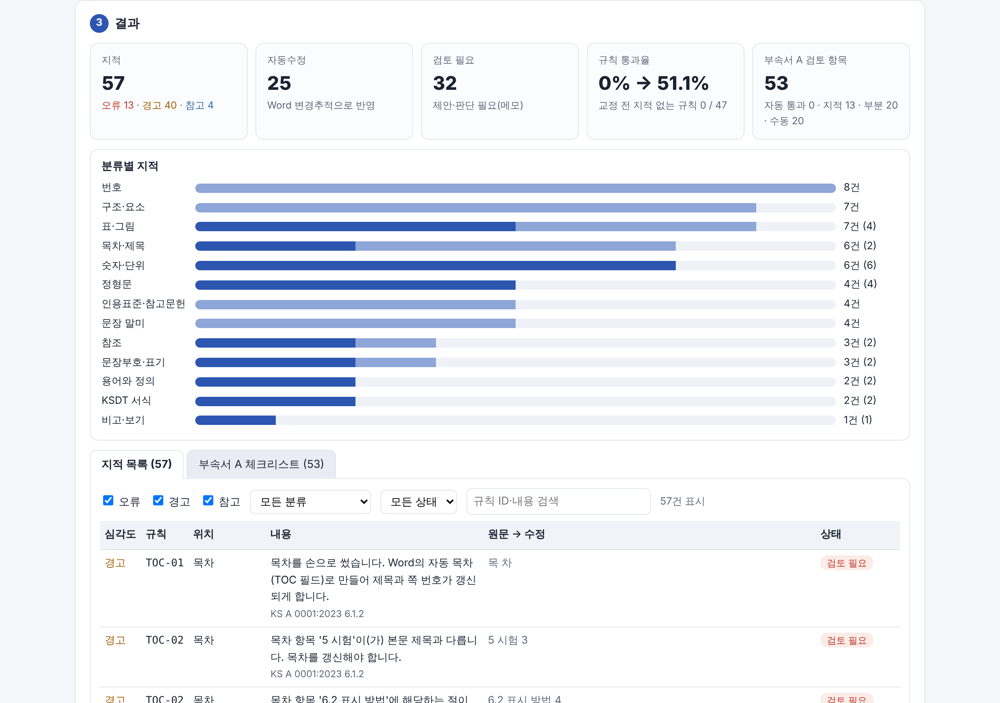
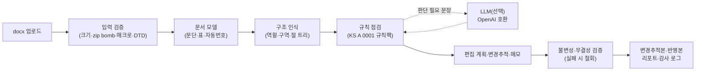

# KS-Fix — KS A 0001 표준안 서식 자동교정 AI

> 한국산업표준(KS) 표준안(.docx)을 **KS A 0001:2023(표준의 서식과 작성방법)** 에 맞춰 점검하고,
> 근거 조항이 달린 **Word 변경추적·메모**로 교정하는 도구입니다. 규칙 엔진만으로 동작하며(LLM 끔이 기본),
> 로컬 LLM을 연결하면 '할 수 있다/해도 된다'처럼 의미 판단이 필요한 문장도 근거와 함께 제안합니다.



## 접속 주소

| 경로 | 주소 | 비고 |
|---|---|---|
| 로컬 웹 UI(실행파일·pip·Docker 공통) | http://127.0.0.1:8765 | 문서는 이 컴퓨터 안에서만 처리 |
| 온라인 데모(설치 없이 브라우저에서) | 준비 중 | 공개 주소가 정해지면 여기에 적습니다. 같은 데모를 로컬에서 여는 방법: [사용자 안내서](docs/USER_GUIDE.md#6-브라우저-데모설치-없음) |
| 결과 예시(실행하지 않고 보기) | [examples/](examples/) | 합성 표준안의 변경추적본·반영본·리포트 |

## 주요 기능

1. **문서 구조 인식** — 표지·목차·머리말·개요·제목·적용범위·인용표준·용어와 정의·본문·부속서·참고문헌·해설을 스타일 이름, 자동번호(numbering.xml 해석), 내용 신호와 문서 흐름(구역 상태 기계)으로 인식합니다.
2. **KS A 0001 규칙 점검** — 조항 근거가 달린 규칙 **47종** + 신뢰성 규칙 3종(카탈로그 84종 중 50종 구현, 목록: [docs/RULES.md](docs/RULES.md)). 지적마다 근거 조항·위치·수정안을 냅니다.
3. **변경추적 자동 교정** — 정형문(머리말·저작권·특허·개요), 표·그림 제목의 위치·형식, 단위 띄어쓰기, 연속부호 '∼', 허용오차·범위 표기, 문장부호, 비고·용어 항목 형식, KSDT 스타일 등 확정할 수 있는 항목은 Word 변경추적으로 고치고 메모에 근거를 답니다. 반영본(clean)도 만들 수 있습니다.
4. **AI 제안(선택)** — OpenAI 호환 LLM(예: 로컬 Ollama의 EXAONE 3.5·Gemma 3)이 문장을 요구·권고·허용·가능성·외적 제약으로 판정하고 서술어만 고친 문장을 근거·신뢰도와 함께 제안합니다. 숫자·단위·표준번호를 바꾸는 제안은 가드레일이 버립니다.
5. **리포트** — 요약 카드, 지적 목록(근거·조치), **부속서 A 검토 항목 53개 체크리스트**, 교정 전후 규칙 통과율을 단일 HTML·JSON으로 냅니다.
6. **기술적 내용 불변 검증** — 수치·단위·표준번호·표 값이 그대로인지 결과 문서를 다시 읽어 확인하고, 다르면 편집을 모두 철회합니다. 입력 파일은 읽기만 합니다.

처리 결과(LLM 끔)

| 문서 | 지적(오류·경고·참고) | 자동수정 | 규칙 통과율(교정 전 → 후) | 처리 시간 |
|---|---|---|---|---|
| 합성 위반본 `sample_01_violations.docx` | 57건(13·40·4) | 25건 | 0 % → 51 % | 약 0.6초 |
| 합성 정상본 `sample_02_clean.docx` | 참고 3건(‘할 수 있다’ 의미 확인) | — | 98 % | 0.1초 미만 |
| 발간 KS 2종(로컬 검증, 저장소 미포함) | 26건 / 53건 | 18건 / 33건 | 87 → 89 % / 83 → 89 % | 1.1초 / 3.7초 |

합성 위반본의 결정형 규칙 기대 지적 재현율은 49/49(100 %), 정상본의 오류·경고는 0건입니다(`tests/golden/`).

## 빠른 실행 (Windows 실행파일 / pip / Docker)

### ① Windows 실행파일(설치 없음)

1. 릴리스 페이지에서 `ksfix-win64.zip`을 받아 압축을 풉니다.
2. `ksfix\ksfix.exe`를 실행하면 로컬 서버가 뜨고 브라우저가 자동으로 열립니다(기본 http://127.0.0.1:8765, 쓰는 중이면 빈 포트).
3. 서명되지 않은 실행파일이라 SmartScreen 경고가 나오면 ‘추가 정보 → 실행’을 누릅니다. 동작 확인은 명령 프롬프트에서 `ksfix.exe --selftest`.

### ② pip(Windows·macOS·Linux, Python 3.11 이상)

```bash
python -m venv .venv
```
Windows는 `.venv\Scripts\activate`, macOS·Linux는 `source .venv/bin/activate`로 가상환경을 켠 뒤:
```bash
pip install ".[web]"
```
```bash
ksfix serve --open
```

### ③ Docker

```bash
docker compose up --build
```
브라우저에서 http://127.0.0.1:8765 를 엽니다(이 컴퓨터에서만 접속, 읽기 전용 컨테이너).

## 사용 방법 (웹 3단계 · CLI 예시)

웹: **① docx 끌어 놓기 → ② 출력 선택**(변경추적본·반영본·점검만, 규칙 범위, LLM) **→ ③ 결과 확인 후 내려받기**(변경추적본·리포트 HTML/JSON·감사 로그). 변경추적본을 Word에서 열면 고친 곳마다 근거 메모가 달려 있고, ‘검토 → 수락/거절’로 하나씩 결정합니다.

CLI:
```bash
ksfix check samples/sample_01_violations.docx -o out
```
```bash
ksfix fix samples/sample_01_violations.docx -o out --mode tracked
```
```bash
ksfix fix samples/sample_01_violations.docx -o out --mode clean
```
```bash
ksfix inspect samples/sample_03_messy_styles.docx
```
```bash
ksfix rules
```

| 출력 파일(`out/`) | 내용 |
|---|---|
| `*.ksfix-tracked.docx` / `*.ksfix-clean.docx` | 변경추적본(수정 + 근거 메모) / 반영본 |
| `*.ksfix-report.html` · `*.ksfix-report.json` | 리포트(요약·지적·체크리스트·검증 결과) |
| `*.ksfix-audit.jsonl` | 감사 로그(편집마다 규칙·위치·전후 텍스트·결정) |

자세한 사용법·옵션: [docs/USER_GUIDE.md](docs/USER_GUIDE.md)

## LLM 연결·교체 방법 (모델 2종 평가 결과)

- 기본값은 **LLM 끔**이며, 모든 핵심 기능이 LLM 없이 동작합니다.
- 연결: `config/llm_profiles.example.yaml`을 `config/llm_profiles.yaml`로 복사해 프로필을 고르거나, 환경변수 `KSFIX_LLM_BASE_URL`·`KSFIX_LLM_MODEL`(`KSFIX_LLM_API_KEY`)을 지정합니다. OpenAI 호환 API(`/v1/chat/completions`)면 Ollama·vLLM·LM Studio·상용 API 모두 같은 방식입니다.
- 교체: 웹 UI의 ‘AI(LLM)’ 선택 또는 CLI `--llm 프로필`만 바꾸면 됩니다. 외부 API 프로필은 화면·명령줄에 **외부 전송 경고**가 표시됩니다.

```bash
ollama pull exaone3.5:7.8b
```
```bash
ksfix fix samples/sample_01_violations.docx -o out --llm ollama-exaone
```

문장 말미 판정(KS A 0001 부속서 I) 평가 — 직접 만든 합성 문장 60개, `ksfix eval --profiles ollama-exaone,ollama-gemma`:

<!-- EVAL_TABLE_START -->
| 모델(로컬 Ollama) | 유형 정확도 | 허용 판별 | ‘반드시’ 판별 | 문장당 시간 |
|---|---|---|---|---|
| EXAONE 3.5 7.8B | 측정 중 | | | |
| Gemma 3 4B | 측정 중 | | | |
<!-- EVAL_TABLE_END -->

평가 방법·혼동행렬: [docs/eval/modal_verbs_eval.md](docs/eval/modal_verbs_eval.md) · 설정 안내: [docs/LLM_SETUP.md](docs/LLM_SETUP.md)

## 모의데이터 (samples/)

모두 직접 만든 **가상의 표준안**(‘KS X 9999 디지털 체중계’)이며 실제 KS 문서·민감정보가 없습니다. `python scripts/make_samples.py`로 언제든 같은 내용으로 다시 만듭니다.

| 파일 | 용도 |
|---|---|
| `sample_01_violations.docx` | 위반 52건을 일부러 넣은 표준안 — 점검·교정 시연용(기대 지적: `sample_01_expected.json`) |
| `sample_02_clean.docx` | KS A 0001에 맞게 쓴 정상본 — 오탐 확인용 |
| `sample_03_messy_styles.docx` | 스타일 없이 손으로 서식을 넣은 문서 — 구조 인식 확인용 |
| `sample_0N_roles.json` | 문단별 정답 역할(구조 인식 정확도 측정용) |

## 구조 (아키텍처 · 규칙 목록)



- 코어(`src/ksfix/`)는 순수 Python(bytes → bytes)이고, CLI·로컬 웹서버·Windows 실행파일·브라우저 데모가 같은 코어를 씁니다.
- 상세 설계: [docs/ARCHITECTURE.md](docs/ARCHITECTURE.md) · 규칙 목록과 근거 조항: [docs/RULES.md](docs/RULES.md) · 개발 계획: [docs/PLAN.md](docs/PLAN.md) · 진행 기록: [docs/PROGRESS.md](docs/PROGRESS.md)

## 신뢰성·보안 설계 (원본 보호 · 불변성 검증 · 오프라인 동작)

- **원본 보호**: 코어는 bytes만 받아 새 bytes를 돌려주며 입력 파일을 열어 둔 채 고치지 않습니다. CLI는 처리 전후 입력 SHA-256을 비교하고 출력 경로가 입력과 같으면 거부합니다.
- **기술적 내용 불변(INV-01)**: 편집 전 문단별 사전 점검 + 편집 후 결과 문서 전체 비교(수치·단위·표준번호·표 셀 값). 하나라도 다르면 모든 편집을 철회하고 메모만 남깁니다.
- **건드리지 않는 곳**: 필드 코드·결과(목차 등), 수식, 그림·텍스트 상자, 기존 변경추적·메모 — 애매하면 자동 수정 대신 메모로 남깁니다.
- **출력 무결성(INV-03)**: 다시 열기, XML 파싱, 변경추적·메모 ID 중복과 범위 짝을 검사합니다.
- **오프라인 동작**: LLM 끔이 기본이고 외부 프로필은 경고합니다. 웹서버는 127.0.0.1에만 바인딩하고, 업로드는 30 MB 한도·임시 파일 1시간 뒤 삭제, 문서 내용은 로그에 남기지 않습니다.
- 자세히: [docs/SECURITY.md](docs/SECURITY.md)

## 알려진 제약

- 입력은 .docx만 지원합니다(.hwp·.doc은 Word·한컴오피스에서 .docx로 저장한 뒤 사용).
- 의미 판단이 필요한 항목(요구·허용 표현, 용어 정의의 적절성 등)은 자동으로 고치지 않고 제안·메모만 합니다. LLM 판정은 합성 평가에서 약 80 %로, 사람이 변경추적에서 수락·거절해야 합니다.
- 카탈로그 84종 중 34종(P1·P2: 표지 서식, 쪽 머리, 용지·여백, 그림 품질 등)은 아직 구현하지 않았습니다(목록은 [docs/RULES.md](docs/RULES.md)).
- 목차 번호·쪽수는 Word가 문서를 열 때 갱신합니다(필드 갱신 확인 창에서 ‘예’).
- 브라우저 데모는 첫 실행 때 인터넷에서 처리 엔진(Pyodide)을 받으며 LLM 기능이 없습니다.
- Windows 실행파일은 코드 서명이 없어 SmartScreen 경고가 나올 수 있습니다.

## 라이선스 · 오픈소스 고지 · 참고한 자료

- 라이선스: MIT(가칭, 소속기관 확인 후 확정) — [LICENSE](LICENSE)
- 오픈소스 고지: [THIRD_PARTY_NOTICES.md](THIRD_PARTY_NOTICES.md)(실행 의존성은 모두 허용형 라이선스, PyInstaller 부트로더 예외·LLM 모델 라이선스 안내 포함)
- 참고한 자료: KS A 0001:2023 표준의 서식과 작성방법(국가기술표준원) — 원문은 저장소에 넣지 않고 조항 번호와 요약만 씁니다. ECMA-376(Office Open XML), python-docx·FastAPI·Pyodide·Ollama 공식 문서
- 변경 이력: [CHANGELOG.md](CHANGELOG.md)

## 개발 경위 (문제 인식 · 접근 방식)

- **문제**: KS는 5년마다 확인·개정 검토를 거치고, 표준안은 KS A 0001의 서식(요소 순서, 정형문, 번호, 표·그림, 단위 표기, 요구·허용 표현 등)을 따라야 합니다. 이 점검은 대부분 사람이 눈으로 하며, 발간본에도 이전 판 정형문·목차 미갱신·단위 표기 편차가 남아 있습니다.
- **접근**: ① 확정할 수 있는 것은 규칙으로(근거 조항 명시), ② 의미 판단이 필요한 문장만 AI로, ③ 모든 수정은 변경추적·메모로 남겨 담당자가 결정, ④ 기술적 내용은 자동 검증으로 보호, ⑤ LLM·인터넷 없이도 동작하도록 설계했습니다.
- **검증**: 합성 표준안 3종(골든 테스트)과 발간 KS 문서 2종(로컬에서만 사용, 외부 전송 없음)으로 오탐을 줄였고, 실제 문서에서 찾은 오탐은 합성 테스트로 옮겨 고정했습니다.
