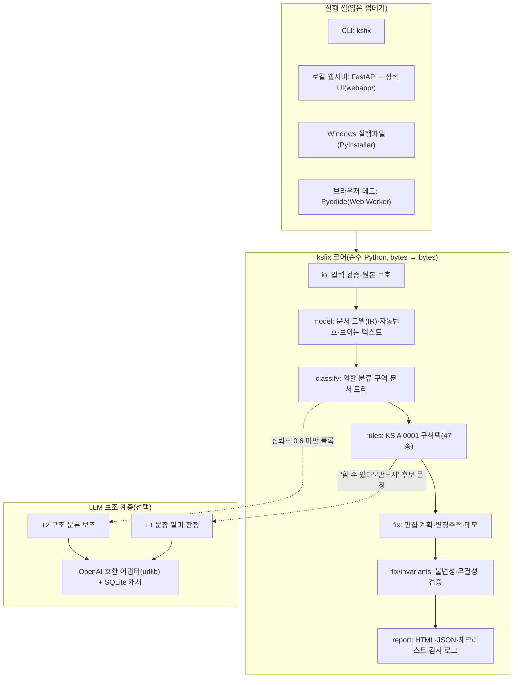
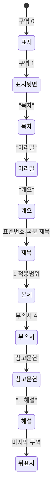

# 아키텍처 (ARCHITECTURE)

KS-Fix는 **순수 Python 코어(bytes → bytes)** 와 그것을 감싸는 **얇은 실행 셸**(CLI·로컬 웹서버·Windows 실행파일·브라우저 데모)로 이루어져 있다.
같은 코어를 네 가지 실행 형태가 그대로 쓰므로 결과가 같고, 업무망으로 옮기기 쉽다.

## 1. 전체 구조



## 2. 처리 흐름

| 단계 | 모듈 | 입력 → 출력 | 실패 시 |
|---|---|---|---|
| 1. 입력 검증 | `io/safety.py`, `io/loader.py` | 업로드 bytes → 검증된 docx, SHA-256 | 크기 초과·zip bomb·암호화·매크로·DTD/ENTITY → 한국어 오류 메시지 |
| 2. 파싱 | `model/builder.py` 외 | docx → `KSDoc`(문단·표·span·스타일·자동번호 라벨·구역) | 해석 못 한 요소는 그대로 두고 계속 |
| 3. 구조 인식 | `classify/heuristics.py`, `tree.py` | 문단 → 역할 + 구역 + 절 트리 | 저신뢰 블록은 LLM 보조(켠 경우) 또는 해당 규칙 제외 |
| 4. 점검 | `rules/registry.py` + 규칙팩 | `KSDoc` → `Finding[]`(규칙 ID·근거 조항·위치·수정안) | 규칙 하나의 예외는 `ksfix.internal` 진단으로 기록하고 계속 |
| 5. 계획 | `fix/planner.py` | 지적 → 자동 수정 / 메모(제안) 결정 | 겹치는 편집은 우선순위로 하나만, 수정 금지 구역·INV-01 위반은 메모로 강등 |
| 6. 수정 | `fix/engine.py` 외 | 편집 계획 → 변경추적본 또는 반영본 + Word 메모 | 편집 실패 시 그 지적만 메모로 강등 |
| 7. 검증 | `fix/invariants.py` | 원본 vs 결과(수락된 상태) 토큰 비교, 출력 무결성 | 불일치면 **모든 편집 철회** 후 메모만 남긴 문서로 재생성 |
| 8. 재점검·리포트 | `api.py`, `report/` | 결과 재점검 → 전후 비교, 체크리스트, 감사 로그 | — |

코어 진입점은 `ksfix.api`의 `check_bytes()`(점검만)와 `fix_bytes()`(점검 + 교정 + 검증)다. 둘 다 파일 경로가 아니라 **bytes를 받고 bytes를 돌려준다**(입력 파일을 열어 둔 채 수정할 방법이 없다).

## 3. 설계 원칙

1. **규칙 우선, AI는 판단이 필요한 곳에만** — 결정형으로 풀리는 것은 정규식·구조 규칙으로 처리하고, "할 수 있다"(허용/가능성)처럼 의미 판단이 필요한 문장만 LLM에 보낸다.
2. **모든 지적에 근거** — 지적마다 KS A 0001:2023의 절·부속서 번호(`clause_ref`)를 단다.
3. **사람이 최종 결정** — 자동 수정도 Word 변경추적으로 남겨 담당자가 수락·거절한다. 근거는 메모로 단다.
4. **기술적 내용 불변** — 수치·단위·표준번호·표 셀 값이 바뀌는 편집은 계획 단계에서 막고(사전 점검), 결과 문서에서 다시 확인한다(사후 검증).
5. **순수 코어** — 코어는 네트워크·subprocess·전역 상태가 없다. LLM 클라이언트는 셸이 만들어 넣어 준다.
6. **모델 비종속** — LLM 없이도 모든 핵심 기능이 동작한다. LLM은 OpenAI 호환 인터페이스로 교체한다.
7. **규칙은 데이터** — 규칙 메타데이터(근거·심각도·우선순위·수정 방식·매개변수)는 `catalog.yaml`, 구현은 분류별 모듈. 규칙팩을 바꾸면 다른 문서표준에도 쓸 수 있다.

## 4. 문서 모델(IR)

`src/ksfix/model/ir.py`

| 타입 | 설명 |
|---|---|
| `Para` | 문단 하나. `text`(보이는 텍스트: 삭제 텍스트·필드 코드 제외, 필드 결과 포함), `spans`(텍스트 구간 ↔ 원본 `w:t`), 스타일 이름, 자동번호 라벨(`"5.1"`, `"부속서 A"`, `"a)"`), 구역 번호, 표 위치, 역할(`Role`)·신뢰도, 소속 절 번호 |
| `Span` | `[start, end)` ↔ 런·노드. `editable`이 False면 자동 수정 금지(필드 결과, 기존 `w:ins`, 그림·수식, 하이퍼링크 경계 등) |
| `Table` | 행 → 열 → 셀 문단, 중첩 여부 |
| `KSDoc` | 모든 문단(표 안 포함)·표·메타데이터·트리, python-docx `Document`(쓰기용) |

구현 포인트
- **스타일은 이름으로** 다룬다. 스타일 ID는 문서마다 다르다(실제 발간본에서 `KSDTf7`이 한 문서에선 표제목, 다른 문서에선 제목 한글).
- **자동번호**: `numbering.xml`의 abstractNum·num·lvlOverride/startOverride와 **스타일 상속 체인**(Heading 2가 Heading 1에서 numId를 물려받고 ilvl만 지정), `lvl/pStyle` 연결(부속서 스타일), 하위 수준 초기화, 문자·로마·가나다 서식을 해석한다. 실제 KS 문서의 목차 캐시 번호와 해석 결과가 일치하는지 테스트한다.
- **필드 상태는 문단을 넘는다**(목차 TOC 필드). 문서 전체에서 하나의 상태 기계를 공유한다.

## 5. 구조 인식

1차로 문단 하나만 보고 후보 역할과 신뢰도를 정하고(스타일 이름, 자동번호 라벨, 텍스트 패턴, 굵게·가운데 정렬), 2차로 **구역 상태 기계**가 문서 흐름에 맞춰 확정한다.



- 본체 안에서는 1단계 절 제목으로 절 종류(적용범위·인용표준·용어와 정의·기호와 약어·일반)를 바꾸고, 종류에 따라 인용표준 항목, 용어 항목(두 가지 꼴: 자동번호 Heading + 줄바꿈 + 용어 / 손입력 "3.1" + 다음 문단), 정의, 출처를 정한다.
- 손으로 친 절 번호는 **직전 절 번호에 이어지는 번호**일 때만 제목으로 인정한다(그림 범례 "1 용접봉 홀더"를 절 제목으로 오인하지 않게).
- 표지·뒤표지는 구역 단위로 판정한다.

## 6. 규칙 엔진

- `@rule("QTY-01")` 데코레이터로 등록하고, 시작할 때 구현된 ID가 모두 `catalog.yaml`에 있는지 검증한다.
- `RuleContext`: 매개변수(카탈로그), 활성 규칙, 정형문·화이트리스트, LLM 클라이언트, 규칙 사이에서 한 번만 계산할 값(LLM 판정 등).
- 규칙은 `Finding`(심각도·메시지·근거·위치·`FixSpec`)을 낸다. `FixSpec.kind`: `replace_text`, `insert_paragraph_after/before`, `move_paragraph`, `set_style`, `set_alignment`, `set_doc_setting` 등. `auto=False`면 제안(메모)만.
- 규칙 목록·근거: [RULES.md](RULES.md)

## 7. 수정 엔진

| 모드 | 설명 |
|---|---|
| `tracked`(기본) | 텍스트 변경은 `w:del`/`w:ins`, 스타일·정렬 변경은 `w:pPrChange`, 문단 삽입·삭제는 문단 표시까지 추적. 각 변경에 Word 메모(근거 조항·규칙 ID·자동수정/제안/AI 제안) |
| `clean` | 자동 수정을 모두 반영한 문서. 판단이 필요한 항목과 AI 제안은 메모로만 |
| `report` | 문서는 만들지 않고 리포트만 |

- **텍스트 편집**: 보이는 텍스트 오프셋 → (런, 런 안 위치) → 런 분할(서식 복사, 탭·줄바꿈이 섞인 런도 처리) → 대상 런을 `w:del`로 감싸고 `w:t`→`w:delText` → 바로 뒤에 원래 서식을 복사한 새 런을 `w:ins`로. 교체는 **단어 단위 최소 차이**로 쪼개 변경 표시를 작게 남긴다("필요하다" → "필**수적이**다").
- **수정 금지 구역**: 필드 코드·필드 결과(TOC·SEQ·REF), 수식(OMML), 그림·텍스트 상자, 기존 `w:ins`/`w:del` 안, 하이퍼링크 경계를 넘는 구간 → 자동 수정 대신 메모.
- **편집 계획**: 같은 문단의 겹치는 편집은 우선순위(P0 > P0b > P1 > P2) → 심각도 → 넓은 구간 순으로 하나만 남기고, 다른 수정에 포함된 지적은 "함께 해결"로 표시한다. 적용은 문단 뒤쪽부터 해 오프셋이 흔들리지 않게 한다.
- **문단 이동**(표 제목을 표 위로, 그림 제목을 그림 아래로): 추적 이동 대신 "삭제 + 삽입" 추적으로 단순화. 서식 변경을 이동보다 먼저 적용하고, 복제본의 리비전 ID를 새로 발급한다.
- **메모**: python-docx 1.2.0 `Comments`로 본문을 만들고 범위 표시·참조 런은 `w:ins` 바깥에 직접 둔다(삽입을 거절해도 메모가 남는다). 기존 메모는 보존한다.
- **ID**: 변경추적·메모 ID는 문서 안 `w:id` 최댓값 + 1000부터 하나씩 발급한다.
- **목차 갱신**: 목차 필드가 있으면 `word/settings.xml`에 `<w:updateFields w:val="true"/>`를 넣는다.

## 8. 검증(신뢰성 규칙)

| ID | 내용 | 방법 |
|---|---|---|
| INV-01 | 기술적 내용 불변 | 편집 전: 문단별로 편집 전후 토큰(수치·표준번호·단위·표 셀 값) 비교 → 바뀌면 그 편집을 메모로 강등. 편집 후: 결과 문서를 다시 읽어(수락된 상태) 문서 전체 토큰 다중집합 비교 → 다르면 모든 편집 철회. 허용된 정규화만 같은 것으로 본다(공백 종류, '~'→'∼', 천 단위 쉼표/공백, 소수 쉼표, '.5'→'0.5', '°C'→'℃', 범위 단위 반복, 비고 라벨 번호, 표준번호 쌍점 공백) |
| INV-02 | 입력 파일 불변 | 코어는 bytes만 다룬다. CLI는 처리 전후 입력 파일 SHA-256을 비교하고, 출력 경로가 입력과 같으면 거부한다 |
| INV-03 | 출력 무결성 | python-docx로 다시 열기, 모든 XML 파싱, 변경추적 ID·메모 ID 중복·충돌, 메모 범위 짝, 참조된 메모 존재 |

## 9. LLM 보조 계층

- `llm/openai_compat.py`: `POST {base_url}/chat/completions`(Ollama·vLLM·LM Studio·공통기반·Solar 등). temperature 0, JSON 모드(모르는 서버면 빼고 재시도), 스키마 검증 실패 시 1회 재시도. 전송은 표준 라이브러리 `urllib`.
- `llm/cache.py`: SQLite 캐시(키 = 모델·프롬프트 버전·입력 해시) → 재현성.
- **T1 문장 말미 판정**(`tasks/modal_verbs.py`, 프롬프트 `modal_verbs.v2`): VRB-01·VRB-02 후보 문장을 묶어 유형 판정 + 말미만 고친 문장. 가드레일 — 공통 접두 비율 ≥ 0.7('반드시' 삭제는 예외), 숫자·단위·표준번호가 바뀌면 폐기, 정형문 제외, 응답 모양 정규화와 빠진 문장 재질의.
- **T2 구조 분류 보조**(`tasks/classify_blocks.py`): 신뢰도 0.6 미만 블록 재판정.
- AI 제안은 변경추적본에서는 "변경추적 + [AI 제안 · 모델 · 신뢰도] 메모", 반영본에서는 메모로만 남는다.
- 자세한 설정: [LLM_SETUP.md](LLM_SETUP.md)

## 10. 실행 형태

| 형태 | 진입점 | 비고 |
|---|---|---|
| CLI | `ksfix check/fix/inspect/rules/eval/serve` | `src/ksfix/cli.py` |
| 로컬 웹서버 | `ksfix serve` → FastAPI(`src/ksfix/web/app.py`) + `webapp/` | 127.0.0.1, 업로드 30 MB, 작업 파일 1시간 뒤 삭제 |
| Docker | `docker compose up --build` | 비루트 사용자, 읽기 전용 파일시스템, 127.0.0.1에만 노출 |
| Windows 실행파일 | `packaging/launcher.py` + `packaging/ksfix.spec` | 빈 포트로 서버 시작 → 브라우저 열기, `--selftest` |
| 브라우저 데모 | `webapp/engine-pyodide.js` + `pyodide-worker.js`, `scripts/build_pages.py` | 같은 UI, 엔진만 교체. 문서가 브라우저 밖으로 나가지 않음 |

웹 UI는 엔진 인터페이스(`window.KSFixEngine` — `init`·`profiles`·`process`)만 쓰므로 서버 엔진과 Pyodide 엔진이 같은 화면을 공유한다.

## 11. 저장소 구조

```
src/ksfix/
  io/        입력 검증(safety), 읽기(loader)
  model/     IR, 스타일, 자동번호, 보이는 텍스트, 빌더
  classify/  패턴, 역할 분류(heuristics), 트리, LLM 보조
  rules/     기본 타입, 레지스트리, 문맥, packs/ksa0001_2023(catalog.yaml·checklist.yaml·규칙 모듈)
  fix/       리비전 ID, 텍스트 편집, 문단 편집, 서식, 메모, 설정, 계획, 적용, 불변성
  llm/       인터페이스, 전송, OpenAI 호환, 캐시, 설정, 프롬프트, 작업(T1·T2), 평가
  report/    JSON, HTML(Jinja2 템플릿), 체크리스트
  web/       FastAPI 앱
  assets/    정형문, 기본 LLM 프로필
webapp/      정적 UI(서버·브라우저 데모 공용, CDN 없음)
packaging/   Windows 실행파일
scripts/     check.py, make_samples.py, make_examples.py, build_pages.py, gen_notices.py, push_gitlab.sh
samples/     합성 표준안 3종 + 정답 역할·기대 지적
examples/    샘플 처리 결과(변경추적본·반영본·리포트·감사 로그)
tests/       unit/ golden/ e2e/ llm_gold/
```
