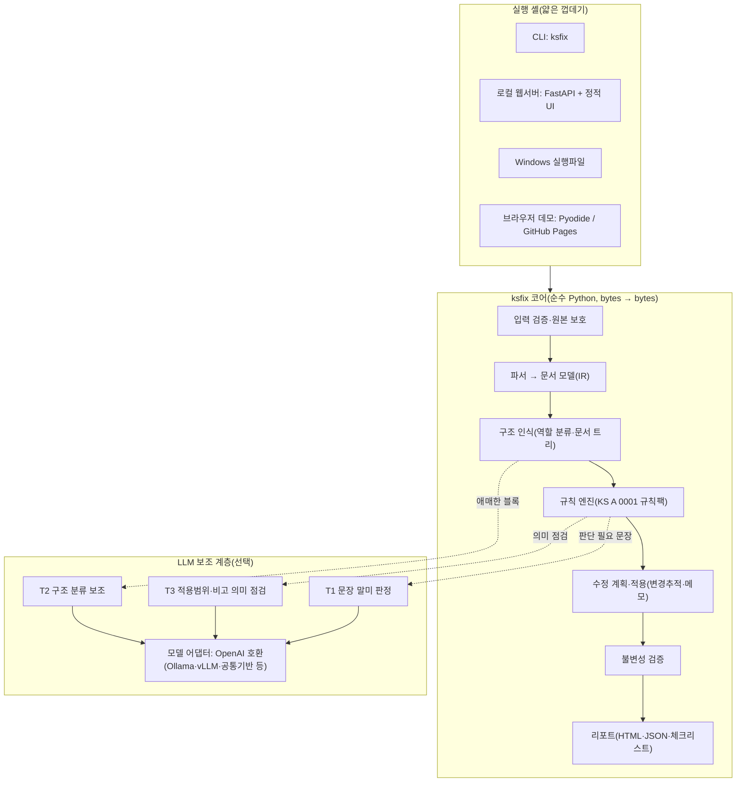

# KS-Fix 개발계획서 (Claude Code 실행용)

**어떤 표준 docx도 KS A 0001:2023에 맞춰 점검·교정하는 AI**

2026년 공공 AI 대전환 챌린지 세션1(AI 정부 실험실 챔피언십) 출품용 · 문서 버전 1.0 · 2026-11-09

> **Claude Code에게:** 이 문서가 대화창에 붙여넣어졌다면, 먼저 이 문서 전체를 `docs/PLAN.md`로 원문 그대로 저장하고, 부록 A를 `CLAUDE.md`로 저장한 다음 §0.2 지시에 따라 Phase 0부터 진행하라. 이미 `docs/PLAN.md`로 저장되어 있다면 바로 §0.2로 가라.

---

## 목차

0. 이 문서 사용법
1. 대회 요건과 설계 반영
2. 문제 정의와 목표
3. 시스템 아키텍처
4. KS A 0001:2023 규칙 카탈로그
5. 개발 단계(Phase 0~11)
6. 테스트·품질 전략
7. GitHub 배포
8. 공공 GitLab 이관과 제출 동결
9. 제출 일정·체크리스트
10. 위험과 대응
11. 확장 로드맵
- 부록 A. CLAUDE.md 원문
- 부록 B. 설정 파일 예시
- 부록 C. CI·스크립트 예시
- 부록 D. 변경추적·메모 구현 메모(검증 완료)
- 부록 E. 정형문 원문
- 부록 F. LLM 프롬프트 템플릿

---

## 0. 이 문서 사용법

### 0.1 사람이 준비할 것 (30분)

| 항목 | 내용 |
|---|---|
| 작업 폴더 | 빈 폴더 `ksfix/` 생성 → 이 파일을 `ksfix/docs/PLAN.md`로 저장 |
| 필수 SW | Python 3.11 이상(3.12 권장), Git, GitHub CLI(`gh auth login` 완료), Claude Code |
| 선택 SW | Ollama + 모델 2종(예: `exaone3.5:7.8b`, `gemma3:4b` — 실제 이름은 `ollama list`로 확인): 모델 비종속 시연용 / LibreOffice: 출력 문서 렌더링 검사용 / Docker |
| 시험용 실제 KS 문서 | `ksfix/local_samples/`에 복사(예: KS C IEC 60974-11, KS C IEC 60384-22). KS A 0001 원문(.doc)은 `local_samples/reference/`에 두면 Claude Code가 규칙 세부를 확인할 때 참고한다(LibreOffice로 docx 변환). **모두 저장소에 올리지 않는다** |
| 계정 | 공공 GitLab(gitlab.aigov.go.kr) 계정, 개인 액세스 토큰(권한 `write_repository`): Phase 11에서 사용 |
| 기관 절차 | **오늘 안에** 국가기술표준원 AI 담당부서에 「기관별 신청 목록」 등재 요청(기관 공문 제출 마감 11.11.) |

### 0.2 Claude Code 실행 지시

1. **역할**: 너는 이 프로젝트의 리드 엔지니어다. Python 기반 OOXML(docx) 자동화, 규칙 엔진, LLM 연동, 웹 UI를 구현한다.
2. **순서**: §5의 Phase 0 → 11. **Phase 6 완료 = 기능상 제출 가능 최소선**이며 이것을 최우선으로 확보한다. 시간이 모자라면 Phase 7~9를 줄이거나 건너뛰되, **Phase 10(문서화)과 Phase 11(GitLab 이관·동결)은 반드시 수행**한다.
3. **Phase 종료 절차(매번)**: `python scripts/check.py` 통과 → `docs/PROGRESS.md` 갱신(한 일·남은 일·알려진 문제) → Conventional Commit → `git push origin main` → 사용자에게 5줄 이내로 보고.
4. **시간 관리**: 마감은 2026-11-11(수). P1 항목이 30분 이상 막히면 중단하고 PROGRESS에 기록한 뒤 다음으로 넘어간다. P2는 구현하지 않고 로드맵에만 둔다.
5. **실행 전에 사용자 확인을 받을 행동**: GitHub 저장소 생성·공개 전환, GitLab 원격 추가·푸시, 릴리스 태그 생성, 외부 유료 API 호출, `git push --force`.
6. **금지**: `local_samples/` 커밋 / 실제 KS 문서를 외부 LLM API로 전송(로컬 모델이나 LLM 끔으로만 시험) / 입력 파일 수정 / 비밀값 커밋 / 제출 동결(§8.6) 이후 GitLab 푸시 / KS 원문 대량 복제(정형문·짧은 인용 외).
7. **불확실할 때**: §0.3 결정사항을 기본값으로 따른다. 바꿔야 한다면 근거와 함께 사용자에게 묻는다.

### 0.3 결정사항(기본값)

| 항목 | 기본값 | 비고 |
|---|---|---|
| 출품 세션·유형 | 세션1 자유주제 · "행정업무 효율화" | 기관별 신청 목록 엑셀에도 같은 값 |
| 과제명(도구 이름) | KS-Fix: KS A 0001 표준안 서식 자동교정 AI | README·참가신청서 함께 수정 |
| 저장소·패키지·CLI 이름 | `ksfix` | |
| GitHub 공개 범위 | 비공개(private) | 무료 계정으로 GitHub Pages(브라우저 데모)를 쓰려면 공개 필요(§7.4) |
| 라이선스 | MIT(가칭) | 업무상 저작물 해당 여부를 소속기관과 확인 후 확정 |
| 기본 LLM | 끔(규칙만으로 동작) | 시연·평가는 로컬 Ollama 모델 2종 |
| 기본 출력 | 변경추적(tracked) docx + HTML/JSON 리포트 | |
| UI 언어 | 한국어 | 코드 식별자는 영어 |

### 0.4 킥오프 프롬프트(Claude Code에 붙여넣기)

```
docs/PLAN.md(KS-Fix 개발계획서)를 끝까지 읽고 §0.2 지시대로 Phase 0부터 진행해줘.
- Phase가 끝날 때마다 테스트 결과를 짧게 보고하고 커밋·푸시해줘.
- GitHub 저장소 생성, GitLab 푸시, 태그 생성은 실행 전에 나에게 확인받아줘.
- 마감은 11월 11일(수)이야. Phase 6(제출 가능 최소선)을 먼저 끝내고 남는 시간에 확장해줘.
- 실제 KS 문서는 local_samples/에 있어. 외부 API로 보내지 말고 로컬에서만 써줘.
```

---

## 1. 대회 요건과 설계 반영

출처: 「2026년 공공 AI 대전환 챌린지 개최계획」 및 붙임1 「참가 안내서」(261104).

| 요건 | 설계 반영 |
|---|---|
| 세션1 본 제출 **11.11.(수)**: 참가신청서(양식1-1)·구동안내서(양식2-1, A4 3~5쪽)·시연영상(약 5분 이내 mp4)·모의데이터(선택) → databus@nia.or.kr | §9 일정·체크리스트, `docs/submission/` 초안 자동 작성, `samples/` 합성 모의데이터 |
| 산출물 일체(소스·실행물)를 **공공 GitLab(gitlab.aigov.go.kr)** 에 등록: 비공개, Topics '2026 공공 AI 대전환 챌린지 세션1', README에 접속 주소·주요 기능·실행·작동 방법, 실행파일은 프로젝트에 함께 등록 | §8 이관 절차, README 골격(§5 Phase 10) |
| **마감 이후 GitLab 산출물 수정 불가**(변경 이력 확인 시 심사 제외 가능) | §8.6 동결 절차(최종 태그·보호 브랜치·원격 제거) |
| 심사위원이 구동안내서대로 구동하지 못하면 제외 가능 | 실행 경로 4가지(pip·Docker·Windows 실행파일·브라우저 데모), 깨끗한 환경 재현 테스트 |
| 예선은 전문가 심사 + **AI 심사**(과제 설명서·산출물·구동 결과) | README·ARCHITECTURE·RULES 문서 구조화, `examples/`에 결과물 동봉, 테스트·CI |
| **모델 비종속**: LLM을 교체할 수 있는 구조, 2종 이상 모델 구동 입증 권장. 젬마·GPT-OSS·엑사원·하이퍼클로바X·솔라는 행안부 AI 공통기반 지원(예정) 모델 | OpenAI 호환 어댑터 + 공급자 플러그인, `ksfix eval`로 모델 2종 이상 비교표 생성 |
| 개발 단계 민감자료 사용 금지(공개자료·합성 모의데이터 가능) | 합성 표준안 생성기, 실제 KS 문서는 `local_samples/`(미커밋), 외부 API 전송 금지 |
| **원본 보호**: 투입 원본은 읽기 전용, 산출물은 별도 위치 | 입력 해시 검증, 출력 디렉터리 분리, 코어는 bytes → bytes |
| 오픈소스 라이선스 준수, 재배포 제한 구성요소는 구동안내서에 명시 | 허용형 라이선스 의존성만 사용, `THIRD_PARTY_NOTICES.md` 생성 |
| '27년 정보화사업 염두: 기능을 넓히기보다 핵심 기능 안정·유지관리 쉬운 구조 | 순수 코어 + 얇은 실행 셸, 규칙 = 데이터(YAML), REST API, Docker |
| 평가: 필요성 20 · 창의성 30 · 활용성 20 · 완성도 15 · 확산가능성 15 | 아래 표 |

| 평가 지표(배점) | KS-Fix가 보여줄 것 |
|---|---|
| 필요성(20) | KS 22,272종(2024년 말)·5년 주기 적정성 검토, KS A 0001 부속서 A 검토항목 54개를 사람이 눈으로 확인, 발간본에도 기계적으로 잡히는 편차 존재(§2.2) |
| 창의성(30) | 규칙 + LLM 하이브리드, KS A 0001 근거 조항이 달린 **Word 변경추적 교정**, 부속서 A 체크리스트 자동 작성, 기술적 내용 불변성 자동 검증 |
| 활용성(20) | 담당자가 쓰던 Word 그대로(수락·거절), 설치 없이 쓰는 경로 제공, 처리 시간 측정치 제시 |
| 완성도(15) | 테스트·CI, 손상 없는 docx 출력, 4가지 실행 경로, 문서화 |
| 확산가능성(15) | 규칙팩 교체로 단체표준·기관 문서표준에 확장, 모델 비종속, 업무망 이식(오프라인 UI·순수 코어) |

---

## 2. 문제 정의와 목표

### 2.1 배경

- KS 보유 종수는 **22,272종**(2024년 말, 지표누리 「한국산업규격(표준화) 현황」, 출처 기술표준통계)이고, KS는 제정일로부터 **5년마다 적정성을 검토**해 개정·확인·폐지한다(국가기술표준원). 단순 계산으로도 해마다 4천 종 이상이 검토 대상이 된다.
- 모든 표준안은 **KS A 0001:2023(표준의 서식과 작성방법)** 과 국가기술표준원 표준 작성용 프로그램(**KSDT**)을 따라야 한다. KS A 0001 부속서 A는 작성자·편집자용 **검토항목 54개**를 제시하는데, 현재는 사람이 하나씩 확인한다.
- 국제표준 부합화(IDT) 표준안은 번역(기계번역 포함)으로 만들어지는 경우가 늘어, 서식·표현 편차를 검증하는 도구가 필요하다.

### 2.2 시범 점검 결과(2026-11-09, 정규식 프로토타입 11종)

발간된 KS 2종에 간이 규칙을 돌려 본 결과다. 오탐이 섞인 **후보치**이며 정밀 검증은 Phase 3에서 한다.

| 점검 | KS C IEC 60974-11 | KS C IEC 60384-22 | 근거 |
|---|---|---|---|
| 연속부호를 '∼'(U+223C) 대신 '~'(U+007E)로 씀 | 17건 | 30건('∼'와 혼용) | 부속서 H(연속부호) |
| 반쌍점(;) 사용 | 1건 | 0건 | 부속서 H(문장 부호) |
| 수치와 단위 붙여쓰기 | 1건("1 000V") | 2건(모두 오탐: "그룹 1A") | 부속서 L |
| 표 제목 줄표 간격 | 0건 | "표 13 —최대", "표 12 —  솔더" 등 | J.2.3 |
| 중복 마침표 | 0건 | 1건("있다..") | 일반 표기 |
| "~할 수 있다"(허용/가능 판정 필요) | 4건 | 10건 | 부속서 I 표 I.3·I.4 |

결론: 발간본에도 **기계적으로 확정 가능한 편차**가 있고, "할 수 있다"처럼 **의미 판단이 필요한 표현**은 AI 보조가 필요하다. 또한 같은 발간본이라도 문서마다 스타일 사용 방식이 다르다(한 문서는 용어 항목을 Heading 2 자동번호로, 다른 문서는 "3.4"를 본문에 직접 입력). 구조 인식은 두 방식을 모두 처리해야 한다.

### 2.3 목표와 비목표

**목표**
1. docx를 올리면 KS A 0001 위반을 찾아 **근거 조항과 함께** 보여 준다.
2. 기계적으로 확정 가능한 위반은 **Word 변경추적**으로 자동 수정한다(담당자가 수락·거절).
3. 판단이 필요한 위반은 **AI 제안 + 메모**로 남긴다.
4. 부속서 A 검토항목 54개 **체크리스트**와 수정 전후 리포트를 만든다.
5. 수치·단위·표준번호·표 값 같은 **기술적 내용은 바꾸지 않음**을 자동 검증한다.

**비목표**: 기술적 내용의 타당성 판단, 번역, 사람 확인 없는 자동 발간, HWP 원본 직접 편집(로드맵).

"어떤 docx도"의 의미: 어떤 docx를 넣어도 **손상 없이 처리하고 결과를 낸다**는 뜻이다. 구조 교정 품질은 입력이 KS 표준안 형태에 가까울수록 높다. 한글 비율이 낮은 문서(예: IEC 영문 원문)는 "KS A 0001 적용 대상 아님" 경고를 낸다.

### 2.4 사용자와 시나리오

| 사용자 | 시나리오 |
|---|---|
| 국가기술표준원 표준 담당 | 심의 전 표준안 서식 검토 → 리포트와 변경추적본으로 보완 요청 |
| 표준개발협력기관·전문위원회 작성자 | 제출 전 자가 점검 → 자동 수정 수락, 메모 항목만 직접 수정 |
| 표준 편집 담당 | 발간 전 교정, 부속서 A 체크리스트 첨부 |
| (확산) 단체표준·기관 문서표준 담당 | 규칙팩만 바꿔 같은 도구로 점검 |

### 2.5 성공 지표(MVP)

| 지표 | 목표 |
|---|---|
| 결정형 규칙 탐지 재현율(합성 표준안에 주입한 위반 기준) | ≥ 95 % |
| 정상 문서 오탐(error·warning) | 문서당 ≤ 3건 |
| 100쪽 안팎 표준 처리 시간(규칙만, 노트북) | ≤ 15초 |
| 기술적 내용 불변성 | 100 %(위반하는 수정은 자동 철회) |
| 출력 docx 무결성(python-docx 재열기, LibreOffice 변환) | 100 % |
| LLM 문장 말미 판정 정확도(합성 골드셋 60문장) | 모델 2종 각각 측정·공개(목표 ≥ 85 %) |

---

## 3. 시스템 아키텍처

### 3.1 전체 구조



### 3.2 처리 흐름

| 단계 | 입력 → 출력 | 실패 시 동작 |
|---|---|---|
| 1. 입력 검증 | 업로드 bytes → 검증된 docx bytes, SHA-256 | 크기 초과·암호화·손상·zip bomb → 명확한 오류 메시지 |
| 2. 파싱 | docx → `KSDoc`(블록·런·스타일·자동번호 라벨·구역) | 해석 못 한 요소는 `UNKNOWN`으로 두고 계속 |
| 3. 구조 인식 | 블록 → 역할(머리말·절 제목·비고·표 제목 등) + 문서 트리 | 낮은 신뢰도 블록은 LLM 보조(켜진 경우) 또는 규칙 제외 |
| 4. 점검 | `KSDoc` → `Finding[]`(규칙 ID·근거 조항·위치·수정안) | 규칙 하나의 예외는 기록 후 다음 규칙 계속 |
| 5. 수정 | `Finding[]` → 편집 계획 → 새 docx(변경추적 또는 반영본) | 겹치는 편집은 우선순위로 하나만, 위험 구간은 메모로 강등 |
| 6. 불변성 검증 | 원본 대비 수치·표준번호·표 값 비교 | 위반 편집 철회 후 재생성 |
| 7. 재점검·리포트 | 수정본 재점검 → 전후 비교 리포트, 체크리스트, 감사 로그 | — |

### 3.3 설계 원칙

1. **규칙 우선, AI는 판단이 필요한 곳에만**: 결정형으로 풀 수 있는 문제에 LLM을 쓰지 않는다.
2. **모든 지적에 근거**: KS A 0001 절·부속서 번호를 붙인다(설명 가능성).
3. **사람이 최종 결정**: 자동 수정도 변경추적으로 제안하고, 수락·거절은 담당자가 한다.
4. **기술적 내용 불변**: 불변성 검증을 통과하지 못한 수정은 자동 철회한다.
5. **순수 코어**: 코어는 bytes → bytes, 네트워크·subprocess·전역 상태 없음 → CLI·웹·브라우저·exe가 같은 코어를 쓰고 업무망 이식이 쉽다.
6. **모델 비종속**: LLM 없이도 핵심 기능이 동작하고, LLM은 OpenAI 호환 표준 인터페이스로 교체한다.
7. **규칙은 데이터**: 규칙팩(YAML 메타데이터 + 플러그인 코드)을 바꿔 KS A 0001 개정과 다른 문서표준에 대응한다.

### 3.4 저장소 구조

```
ksfix/
├─ CLAUDE.md                     # Claude Code 상시 지침(부록 A)
├─ README.md                     # 대회 필수 항목 포함(§5 Phase 10)
├─ LICENSE · CHANGELOG.md · THIRD_PARTY_NOTICES.md
├─ pyproject.toml                # hatchling, extras: web / llm / dev / exe
├─ .env.example · .gitignore · .gitattributes
├─ config/llm_profiles.example.yaml
├─ src/ksfix/
│  ├─ __init__.py · __main__.py · cli.py(argparse) · api.py(process_bytes)
│  ├─ io/        safety.py(크기·zip bomb·XXE 방지) · loader.py
│  ├─ model/     ir.py · builder.py · numbering.py · text.py(보이는 텍스트↔런 매핑) · styles.py
│  ├─ classify/  heuristics.py · tree.py · llm_assist.py
│  ├─ rules/     base.py · registry.py · context.py
│  │  └─ packs/ksa0001_2023/ catalog.yaml · checklist.yaml · structure.py · numbering.py
│  │       · boilerplate.py · verbs.py · punctuation.py · quantities.py · tables_figures.py
│  │       · notes.py · references.py · normrefs.py · terms.py · toc_title.py · styles_fmt.py
│  ├─ fix/       planner.py · textedit.py · paragraphs.py · styles.py · comments.py
│  │             · settings.py · invariants.py · revisions.py(ID 발급·저자·일시)
│  ├─ llm/       base.py · transport.py · openai_compat.py · null.py · cache.py · config.py
│  │  ├─ prompts/ modal_verbs.v1.md · classify_blocks.v1.md · scope_check.v1.md
│  │  └─ tasks/   modal_verbs.py · classify_blocks.py · scope_check.py
│  ├─ report/    json_report.py · html_report.py · checklist.py · templates/report.html.j2
│  ├─ assets/    ksdt_profile.yaml · boilerplate.yaml
│  └─ web/       app.py(FastAPI)
├─ webapp/                       # 정적 UI(서버·브라우저 데모 공용, CDN 없음)
│  ├─ index.html · app.js · styles.css · engine-server.js · engine-pyodide.js(P1)
├─ scripts/      check.py · make_samples.py · push_gitlab.sh · build_pages.py(P1) · gen_notices.py
├─ packaging/    ksfix.spec(PyInstaller) · launcher.py
├─ samples/      # 합성 모의데이터(생성기 산출물, 커밋함)
├─ examples/     # 샘플 처리 결과(변경추적 docx·반영본·리포트)
├─ tests/        unit/ · golden/ · e2e/ · llm_gold/modal_verbs.jsonl
├─ docs/         PLAN.md · PROGRESS.md · ARCHITECTURE.md · RULES.md · USER_GUIDE.md
│                · LLM_SETUP.md · SECURITY.md · eval/ · submission/
├─ local_samples/                # 실제 KS 문서(.gitignore)
├─ Dockerfile · docker-compose.yml
├─ .github/workflows/ ci.yml · release.yml(P1) · pages.yml(P1)
└─ .gitlab-ci.yml                # 기본 비활성(러너 확인 후 사용)
```

의존성(모두 허용형 라이선스): 코어 `python-docx==1.2.0`(MIT, 메모 API 포함), `lxml`(BSD), `PyYAML`(MIT), `Jinja2`(BSD). web extra `fastapi`·`uvicorn`·`python-multipart`. LLM 호출은 표준 라이브러리 `urllib`로 구현해 의존성을 늘리지 않는다. dev extra `pytest`·`pytest-cov`·`ruff`. exe extra `pyinstaller`(GPL + 부트로더 예외: 앱 배포 허용, 구동안내서에 명시).

### 3.5 문서 모델(IR)

```python
# src/ksfix/model/ir.py (요지)
from dataclasses import dataclass, field
from enum import Enum

class Role(str, Enum):
    COVER = "cover"; COVER_INFO = "cover_info"; BACK_COVER = "back_cover"
    TOC_TITLE = "toc_title"; TOC_ENTRY = "toc_entry"
    FOREWORD_TITLE = "foreword_title"; FOREWORD = "foreword"
    INTRO_TITLE = "intro_title"; INTRO = "intro"
    STD_NUMBER = "std_number"; TITLE_KO = "title_ko"; TITLE_EN = "title_en"
    HEADING = "heading"                  # level·number·title 속성 사용
    BODY = "body"; LIST_ITEM = "list_item"
    NOTE = "note"; EXAMPLE = "example"; REMARK = "remark"      # 비고·보기·참고
    TABLE_CAPTION = "table_caption"; FIGURE = "figure"; FIGURE_CAPTION = "figure_caption"
    UNIT_LABEL = "unit_label"; FORMULA = "formula"
    NORMREF_INTRO = "normref_intro"; NORMREF_ENTRY = "normref_entry"
    TERMS_INTRO = "terms_intro"; TERM_NUMBER = "term_number"; TERM = "term"
    DEFINITION = "definition"; TERM_SOURCE = "term_source"
    ANNEX_HEADING = "annex_heading"; ANNEX_STATUS = "annex_status"; ANNEX_TITLE = "annex_title"
    BIBLIO_TITLE = "biblio_title"; BIBLIO_ENTRY = "biblio_entry"
    COMMENTARY_TITLE = "commentary_title"; COMMENTARY = "commentary"
    EMPTY = "empty"; UNKNOWN = "unknown"

@dataclass
class Span:                 # 보이는 텍스트 구간 ↔ 원본 w:r 위치
    start: int; end: int; run_index: int; run_offset: int

@dataclass
class Para:
    idx: int                # 문서 전체 블록 순번(안정 ID)
    xml: object             # lxml w:p 요소(쓰기 시 직접 수정)
    text: str               # 보이는 텍스트: 삭제 텍스트·필드 코드 제외, 필드 결과 포함
    spans: list[Span]
    style_id: str | None; style_name: str | None
    num_label: str | None   # 자동번호 렌더링 결과: "5.1", "부속서 A", "a)"
    num_level: int | None
    section_idx: int = 0
    in_table: bool = False; table_idx: int | None = None
    has_drawing: bool = False; has_field: bool = False; has_math: bool = False
    role: Role = Role.UNKNOWN; role_conf: float = 0.0
    clause_no: str | None = None        # 소속 절·항 번호(트리 구성 후)
    attrs: dict = field(default_factory=dict)   # heading level/number/title 등

@dataclass
class Table:
    idx: int; xml: object
    cells: list[list[list[Para]]]       # 행 → 열 → 셀 안 문단
    nested: bool; section_idx: int

@dataclass
class KSDoc:
    blocks: list[Para | Table]
    meta: dict = field(default_factory=dict)  # std_number·title_ko·title_en·adoption·hangul_ratio
    tree: object | None = None
```

구현 메모
- **자동번호 해석(numbering.py)**: `numbering.xml`의 abstractNum(start·numFmt·lvlText)과 num(lvlOverride·startOverride)을 읽고, **스타일 상속 체인으로 numPr을 해석**한다(실제 KSDT 문서는 Heading 2가 Heading 1을 basedOn으로 numId를 물려받고 ilvl만 지정). 부속서 제목은 lvlText "부속서 %1" + upperLetter일 수 있다. 상위 수준이 증가하면 하위 수준을 초기화한다.
- **검증 방법**: 실제 KS 문서의 TOC 필드 캐시 텍스트("5.1 시험 조건")와 해석 결과가 일치하는지 테스트한다(`local_samples/`가 있을 때만 실행되는 테스트).
- **보이는 텍스트(text.py)**: `w:t`만 모으고 `w:delText`, `w:instrText`, fldChar begin~separate 사이(필드 코드)는 제외한다. `w:hyperlink`, `w:sdtContent`, `w:ins` 안의 런은 포함한다.
- 기존 변경추적이 있는 문서는 "수락된 상태"로 읽고 경고한다. 수정은 `--accept-existing-changes` 옵션이 없으면 메모만 남긴다.

### 3.6 구조 인식(역할 분류)

신호를 점수로 합산해 역할을 정한다.

| 신호 | 예 |
|---|---|
| 스타일 이름 | `Heading 1~5`, `[KSDT] 표제목`, `[KSDT] 그림제목`, `[KSDT] 부속서 A`, `[KSDT] A.1`, `[KSDT] 머리말 제목`, `toc 1~9`, `table of figures` |
| 자동번호 라벨 | "5.1", "부속서 A", "a)" |
| 텍스트 패턴 | 절 제목 `^\d+(\.\d+)*\s+\S` / 비고 `^비고(\s*\d+)?\s` / 보기 `^보기(\s*\d+)?\s` / 참고 `^참고(\s*\d+)?\s` / 캡션 `^(표\|그림)\s*[A-Z]{0,2}\.?\d+` / 참고문헌 `^\[\d+\]` / 출처 `^\[출처` / `^단위\s*:` / `^\((규정\|참고)\)$` |
| 제목 정규화 | KS 문서는 "머  리  말", "목    차", "해  설"처럼 글자 사이를 띄우므로 **공백을 지운 뒤** 비교 |
| 위치·구역 | 구역 0~1 = 표지·표지 뒷면, TOC 필드 구역, "용어와 정의" 절 안의 항목 패턴, 마지막 구역 = 뒤표지 |
| 서식 | 굵게·가운데 정렬·글자 크기·그림(drawing) 포함 여부·표 안 여부 |
| 제외 | TOC·표 목차 항목(끝에 쪽 번호)과 "표 2를 참조한다." 같은 본문 문장은 캡션이 아님 |

신뢰도 0.6 미만 블록은 LLM 보조(T2)를 켠 경우 묶음(최대 20블록, 앞뒤 문맥 포함)으로 판정을 요청하고, 꺼진 경우 해당 블록에 의존하는 규칙을 건너뛴다(오탐 방지).

### 3.7 규칙 엔진

```python
# src/ksfix/rules/base.py (요지)
from dataclasses import dataclass
from typing import Iterable, Literal, Protocol

@dataclass
class FixSpec:
    kind: Literal["replace_text", "set_style", "insert_paragraph_before", "insert_paragraph_after",
                  "delete_paragraph", "move_paragraph", "set_run_props", "set_alignment",
                  "set_table_header", "set_doc_setting"]
    target: int                      # 블록 idx
    start: int | None = None; end: int | None = None
    text: str | None = None; style: str | None = None; props: dict | None = None
    auto: bool = True                # False면 제안(메모)만

@dataclass
class Finding:
    rule_id: str
    severity: Literal["error", "warning", "info"]
    message: str                     # 한국어, 무엇이 왜 문제인지 한 문장
    clause_ref: str                  # 예: "KS A 0001:2023 부속서 L"
    block: int; start: int | None; end: int | None; snippet: str
    fix: FixSpec | None = None
    source: Literal["rule", "llm"] = "rule"
    confidence: float = 1.0
    llm_model: str | None = None

class Rule(Protocol):
    id: str
    def check(self, doc: "KSDoc", ctx: "RuleContext") -> Iterable[Finding]: ...
```

`catalog.yaml` 항목 예시(메타데이터와 매개변수는 데이터로 관리):

```yaml
pack: ksa0001-2023
title: "KS A 0001:2023 표준의 서식과 작성방법"
rules:
  - id: QTY-01
    title: "수치와 단위기호 사이 띄어쓰기"
    clause: "부속서 L, J.3"
    category: "숫자·단위"
    severity: warning
    method: deterministic          # deterministic | llm | hybrid
    autofix: auto                  # auto | suggest | none
    priority: P0
    applies_to: [body, list_item, note, example, table_cell, definition]
    params:
      auto_units: [mm, cm, km, µm, nm, kg, mg, kN, MPa, kPa, kV, mV, mA, kW, kHz, MHz, GHz, Hz, ms, min, dB, mL, "℃", "%", "Ω", "kΩ", "MΩ"]
      suggest_only_units: [m, g, N, V, A, W, s, h, K, L]   # 한 글자 단위는 제안만(오탐 방지)
    message: "수치와 단위기호 사이를 한 칸 띄웁니다(예: 5 mm, 60 %)."
```

- 규칙은 `@rule("QTY-01")` 데코레이터로 등록한다. 시작 시 catalog와 구현의 ID가 1:1인지 검증한다.
- `RuleContext`는 매개변수, 활성 규칙 집합, 정형문 화이트리스트, LLM 클라이언트(없으면 Null)를 가진다.
- 규칙 하나에서 예외가 나면 `ksfix.internal` 진단으로 기록하고 나머지 규칙은 계속 실행한다.

### 3.8 수정 엔진

| 모드 | 설명 |
|---|---|
| `tracked`(기본) | 텍스트 변경은 `w:del`/`w:ins`, 스타일 변경은 `w:pPrChange`, 문단 삽입·삭제는 문단 표시 `w:ins`/`w:del`로 기록. 각 변경에 Word 메모(근거 조항·규칙 ID) |
| `clean` | 자동 수정을 모두 반영한 문서. AI 제안은 반영하지 않고 메모로만 |
| `report` | 문서는 만들지 않고 리포트만 |

- **텍스트 편집 알고리즘**: 보이는 텍스트 오프셋 → (런, 런 내부 오프셋) 매핑 → 시작·끝에서 런 분할 → 대상 런을 `w:del`로 감싸고 `w:t` → `w:delText` → 바로 뒤에 원래 첫 런의 `w:rPr`을 복사한 새 런을 `w:ins`로 삽입. 부록 D의 방식은 실제 KS 문서에서 검증했다(python-docx 재열기, LibreOffice PDF 변환 성공, 변경 표시 확인).
- **안전 구역(자동 수정 금지, 메모로 강등)**: 필드 코드와 필드 결과(TOC·SEQ·REF), 수식(OMML), 그림·텍스트 상자, 기존 `w:ins`/`w:del` 내부, 하이퍼링크 경계를 가로지르는 구간, 각주 참조.
- **편집 계획(planner.py)**: 같은 블록의 겹치는 편집은 규칙 우선순위(P0 > P0b > P1)와 severity로 하나만 남기고 충돌을 감사 로그에 남긴다. 적용은 문서 뒤쪽부터 해 오프셋이 흔들리지 않게 한다.
- **문단 이동**(예: 표 아래에 있는 표 제목을 위로): 추적 이동(`w:moveFrom`/`w:moveTo`) 대신 "삭제 + 삽입" 추적으로 단순화한다.
- **메모**: `python-docx 1.2.0`의 `Document.add_comment(runs, text, author, initials)` 사용. 작성자 "KS-Fix", 본문 형식 `[규칙 ID · 근거 조항] 설명 (자동수정|제안|AI 제안 · 모델명 · 신뢰도 0.86)`. **기존 메모는 보존**한다(발간본 샘플에도 메모 2건이 있었다).
- **목차 갱신**: `word/settings.xml`에 `<w:updateFields w:val="true"/>`를 넣어 Word가 열 때 TOC를 갱신하게 한다.
- **불변성 검증(invariants.py)**: 원본과 결과(수락된 상태) 각각에서 숫자, 표준번호(KS·ISO·IEC 패턴), 단위 토큰, 표 셀 값을 뽑아 정규화(공백·'~'→'∼'·천 단위 쉼표 등 허용된 변환만)한 뒤 다중집합을 비교한다. 정형문 삽입처럼 토큰을 추가하는 규칙은 허용 목록에 있는 토큰만 인정한다. 불일치를 일으킨 편집은 철회하고 메모로 바꾼다.
- **원본 보호**: 처리 전후 입력 파일의 SHA-256이 같아야 한다. 출력 파일명은 `<원본이름>.ksfix-tracked.docx`, `.ksfix-clean.docx`, `.ksfix-report.html`, `.ksfix-report.json`, `.ksfix-audit.jsonl`.

### 3.9 LLM 보조 계층

```python
# src/ksfix/llm/base.py (요지)
class LLMClient(Protocol):
    name: str                                  # 예: "ollama/exaone3.5:7.8b"
    def complete_json(self, system: str, user: str, schema: dict, *,
                      temperature: float = 0.0, timeout: float = 60.0) -> dict: ...
```

| 공급자 | 연결 방식 | 비고 |
|---|---|---|
| `none` | LLM 끔 | 기본값. 모든 핵심 기능 동작 |
| `openai_compat` | `POST {base_url}/chat/completions` | Ollama(`http://localhost:11434/v1`), vLLM, LM Studio, OpenRouter, Upstage Solar 등 |
| 공통기반 | 행안부 AI 공통기반 API 규격 확인 후 `openai_compat` 프로필 또는 전용 어댑터 | 세션1·2 대상 "독자 AI API 토큰 지원" 안내는 databus.kr 확인 |

전송 계층(`transport.py`)을 분리해 CPython에서는 `urllib`, 브라우저(Pyodide)에서는 Web Worker의 동기 XHR을 쓸 수 있게 한다(브라우저 LLM은 P2). 프로필 값의 `${환경변수}`는 로딩 시 치환한다.

LLM이 꺼져 있으면 T1 후보 문장은 수정안 없이 "판단 필요(info)"로만 표시한다. 규칙 기능만으로도 담당자가 확인할 문장 목록을 받을 수 있다.

**LLM 작업(좁고 검증 가능한 작업만)**

| 작업 | 대상 | 출력 | 우선 |
|---|---|---|---|
| T1 문장 말미 판정 | 정규식이 미리 고른 후보 문장("할 수 있다", "될 수 있다", "가능하다", "반드시", "필요가 있다", "바람직하다" 등) | 유형(요구사항·권고사항·허용·가능성/역량·외적 제약·설명·판단보류), 적합 여부, 말미만 고친 문장, 이유, 신뢰도 | P0 |
| T2 구조 분류 보조 | 신뢰도 0.6 미만 블록 | 역할 + 신뢰도 | P0b |
| T3 의미 점검 | 적용범위·비고·보기·참고 부속서 문장 | 요구사항 포함 여부 + 근거 | P1 |
| T4 KS 골격 재구성 제안 | KS 형태가 아닌 문서 | 기존 제목 → KS 요소 대응표 | P2 |

**가드레일**
1. temperature 0, JSON 응답만 허용(지원하면 `response_format={"type":"json_object"}`, 아니면 첫 JSON 블록 추출). 스키마 검증 실패 시 1회 재시도 후 건너뜀.
2. 제안 문장은 원문과 **앞부분이 일치**해야 한다(공통 접두 비율 ≥ 0.7, 서술어만 변경). 숫자·단위·표준번호가 바뀌면 폐기.
3. AI 제안은 `clean` 모드에서도 자동 반영하지 않고 변경추적 + 메모로만 남긴다(설정으로 신뢰도 ≥ 0.9만 반영 가능).
4. 응답 캐시(SQLite, 키 = 모델·프롬프트 버전·입력 해시) → 재현성과 비용 절감. 리포트에 모델 이름·프롬프트 버전을 기록한다.
5. 정형문 화이트리스트(머리말 저작권 문구의 "될 수 있다" 등)는 판정 대상에서 뺀다.
6. 외부 API 프로필이 선택되면 UI·CLI에서 "문서 문장이 외부로 전송됩니다" 경고를 띄운다.

**모델 비종속 입증(`ksfix eval`)**: `tests/llm_gold/modal_verbs.jsonl`(직접 만든 합성 문장 60개, 유형별 10개)로 프로필별 정확도·혼동행렬·평균 응답 시간을 계산해 `docs/eval/`에 마크다운 표로 저장한다. README에 모델 2종 이상의 결과를 싣는다.

### 3.10 리포트

- **HTML(단일 파일, 외부 리소스 없음)**: 요약 카드(지적 수·자동수정 수·검토 필요 수·규칙 통과율 수정 전 → 후), 분류별 막대, 지적 목록(심각도·분류·자동수정 여부 필터, 근거 조항, 원문 → 수정 미리보기), 부속서 A 체크리스트 탭, 처리 정보(규칙팩 버전·모델·처리 시간).
- **규칙 통과율** = 지적이 0건인 적용 규칙 수 ÷ 적용 규칙 수 × 100. 단일 "점수"보다 정의가 분명하다.
- **JSON**: 기계 판독용(CI·외부 연계).
- **체크리스트**: `checklist.yaml`로 54개 항목을 규칙 ID에 매핑(§4.4). 상태는 자동 통과 / 자동 지적 n건 / 부분 자동 / 수동 확인.
- **감사 로그(JSONL)**: 적용·철회된 모든 편집(규칙 ID·전후 텍스트·모드·시각·모델).

### 3.11 인터페이스

**CLI**

| 명령 | 설명 |
|---|---|
| `ksfix check FILE -o OUT [--rules P0,P0b] [--llm PROFILE] [--fail-on error]` | 점검만, JSON·HTML 리포트 |
| `ksfix fix FILE -o OUT [--mode tracked\|clean] [--llm PROFILE]` | 점검 + 교정 문서 + 리포트 |
| `ksfix inspect FILE [--json]` | 블록별 역할·번호·스타일(디버깅·시연용) |
| `ksfix rules [--markdown]` | 규칙 목록(→ `docs/RULES.md` 생성) |
| `ksfix eval --profiles A,B` | LLM 골드셋 평가 |
| `ksfix serve [--host 127.0.0.1] [--port 8765] [--open]` | 로컬 웹 UI |

**REST API(FastAPI)**: `GET /api/v1/health`, `GET /api/v1/rules`, `GET /api/v1/llm/profiles`, `POST /api/v1/process`(multipart: file, options JSON → 요약 + 다운로드 URL), `GET /api/v1/files/{job_id}/{name}`. 임시 파일은 작업별 디렉터리에 저장하고 1시간 뒤 삭제. 업로드 한도 30 MB. 기본 바인딩 127.0.0.1.

**웹 UI(한국어, CDN 없음 → 업무망에서도 동작)**: ① 문서 올리기(끌어놓기) ② 옵션(출력 모드, 규칙 범위, LLM 프로필 + 외부 전송 경고) ③ 결과(요약 카드·지적 목록·체크리스트) ④ 내려받기(변경추적본·반영본·리포트). 같은 `webapp/`을 브라우저 데모가 재사용한다(엔진만 `engine-server.js` ↔ `engine-pyodide.js` 교체).

### 3.12 보안·개인정보·저작권

- XML은 `lxml`로 `resolve_entities=False`, `no_network=True` 파싱(XXE 방지). 압축 해제 총량·파일 수 한도(zip bomb 방지). 매크로(.docm)·암호화 문서는 거부.
- 웹 서버는 기본 127.0.0.1, 문서 내용은 로그에 남기지 않는다. 임시 파일 자동 삭제.
- 비밀값은 `.env`(커밋 금지)와 환경변수. CI에서 비밀값 패턴 검사.
- **저작권**: KS 문서(특히 IEC·ISO 부합화 표준)는 저작권 보호 대상이므로 저장소에 넣지 않는다. 시험·시연은 **합성 표준안**으로 하고, 규칙 설명은 요약 서술 + 조항 번호로 쓴다. 정형문(부록 E)처럼 도구 기능에 꼭 필요한 짧은 문구만 담는다.
- 실제 표준안(미발간 초안 포함)은 외부 LLM API로 보내지 않는다. 로컬 모델 또는 LLM 끔으로만 처리한다.

### 3.13 실행·배포 형태

| 형태 | 대상 | 우선 |
|---|---|---|
| `pip install` + `ksfix serve` | 심사위원·개발자(가상 개발환경 포함) | P0 |
| Docker(`docker compose up`) | 서버 설치·업무망 이식 | P0 |
| Windows 실행파일(zip, 더블클릭 → 브라우저 자동 열림) | 설치가 어려운 공무원 PC | P1 |
| 브라우저 데모(Pyodide, GitHub Pages) | 설치 없이 바로 체험(규칙 기능, LLM 제외) | P1 |

---

## 4. KS A 0001:2023 규칙 카탈로그

### 4.1 표기

- **방식**: 결정 = 결정형 규칙, LLM = 의미 판단, 결정+LLM = 결정형으로 후보 → LLM 확인
- **수정**: 자동 = 변경추적 자동 수정 / 제안 = 수정안을 메모·변경추적 제안으로 / 메모 = 지적만
- **우선**: P0 = 수직 슬라이스·MVP(반드시), P0b = MVP 확장(가능한 한), P1 = 시간 여유 시, P2 = 로드맵
- 근거 표기는 KS A 0001:2023의 절·부속서 번호다. 부속서 H·L처럼 하위 번호가 자동번호인 곳은 소제목으로 적었다.

### 4.2 규칙 표

**A. 구조·요소(5.1, 5.2.7~5.2.9, 6.x)**

| ID | 근거 | 점검 내용 | 방식 | 수정 | 우선 |
|---|---|---|---|---|---|
| STR-01 | 5.1.3 표 3, 6.1.3, 6.3 | 필수 요소: 머리말, 제목(국문·영문), 1 적용범위, 2 인용표준, 3 용어와 정의 | 결정 | 메모(골격 삽입 제안) | P0b |
| STR-02 | 5.1.3 표 3, 5.2.7~5.2.9 | 요소 순서: 목차 → 머리말 → 개요 → 제목 → 적용범위 → 인용표준 → 용어와 정의 → 본문 → 부속서 → 참고문헌 → 색인 → 해설 | 결정 | 메모 | P0b |
| STR-03 | 5.2.4 | 미결문단: 절·항 제목과 첫 하위 항 사이의 번호 없는 문단(적용범위·인용표준·용어와 정의·기호와 약어·부속서 도입부 제외) | 결정 | 메모("N.1 일반사항" 신설 제안) | P0 |
| STR-04 | 6.1.3, 6.2, 6.3.2, 6.5.2, 6.5.3, 6.6.2, 5.2.9 | 머리말·개요·적용범위·비고·보기·참고·각주·해설에 요구·권고·허용 표현 금지(참고 부속서는 선택적 요구사항 허용 → 경고) | 결정+LLM | 메모 | P0 |
| STR-05 | 6.1.3 | 머리말에 그림·표 금지 | 결정 | 메모 | P1 |
| STR-06 | 5.2.7 | 참고문헌은 마지막 부속서 뒤 | 결정 | 메모 | P0b |
| STR-07 | 6.1.2 비고 | 표·그림 목차는 필요한 경우 외 작성하지 않음 | 결정 | 메모 | P1 |

**B. 번호(5.2)**

| ID | 근거 | 점검 내용 | 방식 | 수정 | 우선 |
|---|---|---|---|---|---|
| NUM-01 | 5.2.2 | 절 번호는 적용범위 = 1부터 연속 | 결정 | 메모 | P0 |
| NUM-02 | 5.2.3 | 같은 단계에 항이 하나뿐이면 안 됨(10.1만 있고 10.2 없음) | 결정 | 메모 | P0 |
| NUM-03 | 5.2.3 | 세분은 최대 5단계(예: 5.1.1.1.1) | 결정 | 메모 | P0b |
| NUM-04 | 5.2.3 | 같은 단계 항의 제목 유무 일관 | 결정 | 메모 | P1 |
| NUM-05 | 5.2.2·5.2.3, 6.1.2 | 손으로 친 번호("5.1 시험 조건"을 본문 스타일로 입력) → 자동번호 제목 스타일 | 결정 | 자동(해석 번호 = 입력 번호일 때만) | P1 |
| NUM-06 | 5.2.6 | 부속서: "부속서 A"부터 순서대로, 다음 행 "(규정)"/"(참고)", 다음 행 제목. 부속서 안은 A.1, 표 A.1, 그림 A.1, 식 (A.1) | 결정 | 메모(일부 자동) | P0b |
| NUM-07 | J.1.3, J.2.2, J.4.3 | 그림·표·식 번호는 각각 1부터 연속·독립, 식 세분 (2a) 금지 | 결정 | 메모 | P0b |
| NUM-08 | 5.2.5 | 목록 기호: 줄표(—)·가운뎃점(•)·a) 및 하위 1). 그 밖의 기호(①, ㉮, -, ○ 등) 지양 | 결정 | 자동("-", "–" → "—") | P1 |

**C. 정형문(6.1.3, 6.2, 6.3.2, 6.4.1, 6.4.2, 부속서 E·N)** — 문구는 부록 E

| ID | 근거 | 점검 내용 | 방식 | 수정 | 우선 |
|---|---|---|---|---|---|
| BLT-01 | 6.1.3, E.1 | 머리말 발행정보 정형문(제정·개정·통합·분할·단체표준 기초) | 결정(유사도) | 제안 | P1 |
| BLT-02 | E.1 | 머리말 저작권 정형문(3문장) 존재·문구 일치 | 결정(유사도) | 자동(교체·삽입) | P0 |
| BLT-03 | 6.4.1 | 인용표준 도입 정형문, 인용표준이 없으면 "해당사항 없음" | 결정(유사도) | 자동 | P0 |
| BLT-04 | 6.4.2 | 용어와 정의 도입 정형문(두 가지 꼴), 용어가 없으면 "해당사항 없음" | 결정(유사도) | 자동 | P0 |
| BLT-05 | 6.3.2 | 적용범위 표현: "이 표준은 …에 대하여 규정한다.", "이 표준은 …에 적용될 수 있다.", "이 표준은 …에 적용되지 않는다." | LLM | 제안 | P1 |
| BLT-06 | 부속서 N | 해설 도입문 | 결정 | 자동 | P0b |
| BLT-07 | 6.2, E.2 | 부합화 표준(KS X ISO/IEC …)의 개요에 원국제표준 판·연도 정형문 | 결정 | 제안 | P1 |

유사도 판정: 공백·문장부호 정규화 후 `difflib.SequenceMatcher` 비율 ≥ 0.85면 "변형된 정형문"으로 보고 정확한 문구로 교체, 0.5 미만이면 "누락"으로 보고 삽입한다.

**D. 조항의 문장 말미(부속서 I)**

| ID | 근거 | 점검 내용 | 방식 | 수정 | 우선 |
|---|---|---|---|---|---|
| VRB-01 | 표 I.1, 표 I.5 | "반드시 ~하여야 한다"(must)는 외적 제약에만. 요구사항은 "~하여야 한다" | 결정+LLM | 제안("반드시" 삭제) | P0 |
| VRB-02 | 표 I.3, 표 I.4 | 허용은 "~해도 된다", 가능성·역량은 "~할 수 있다". "할 수 있다"가 허용 의미면 교정 | LLM | 제안 | P0 |
| VRB-03 | 표 I.3 | 허용 문맥의 "가능하다/불가능하다" 금지 | LLM | 제안 | P1 |
| VRB-04 | 표 I.1 | 금지 표현은 "~하여서는 안 된다"(비표준 예: "~하면 안 된다", "~하지 말 것") | 결정 | 제안 | P0b |
| VRB-05 | 표 I.2 | 권고는 "~하는 것이 좋다", "~하여야 할 것이다"(부정: "~하지 않는 것이 좋다") | LLM | 제안 | P1 |
| VRB-06 | 표 I.1 | (선택 규칙, 기본 끔) "~해야 한다" → "~하여야 한다" 표기 통일 | 결정 | 자동 | P2 |

**E. 문장부호·표기(부속서 H)**

| ID | 근거 | 점검 내용 | 방식 | 수정 | 우선 |
|---|---|---|---|---|---|
| PUN-01 | 부속서 H(문장 부호) | 반쌍점(;) 사용 금지. 뒤표지 ICS 구분자는 제외 | 결정 | 메모 | P0b |
| PUN-02 | 부속서 H(연속부호) | 연속부호는 "∼"(U+223C). "~", "～", "〜" 교정 | 결정 | 자동 | P0 |
| PUN-03 | 부속서 H(인용부호), 6.4.1 | 「 」(법령 인용) → 표준 본문에서 법령 인용 지양, 참고문헌으로 | 결정 | 메모 | P1 |
| PUN-04 | 부속서 H(가운뎃점) | 가운뎃점은 지양, 가운뎃점으로 나열한 끝말을 "및"·"또는"으로 잇지 않음 | 결정 | 메모 | P1 |
| PUN-05 | 부속서 H(및/또는) | "및/또는"은 혼동되면 나누어 열거 | 결정 | 메모 | P2 |
| PUN-06 | 일반 표기 | 중복 마침표, 문장부호 앞 공백, 이중 공백 | 결정 | 자동 | P0b |

**F. 숫자·단위·수치(J.3, J.4.4, 부속서 L)**

| ID | 근거 | 점검 내용 | 방식 | 수정 | 우선 |
|---|---|---|---|---|---|
| QTY-01 | 부속서 L, J.3 | 수치와 단위기호 사이 띄어쓰기("5mm" → "5 mm", "60%" → "60 %"). 평면각 °·′·″ 제외 | 결정 | 자동(다문자 단위) / 제안(한 글자 단위) | P0 |
| QTY-02 | J.3 | 소수점은 마침표, 1 미만 소수는 앞에 0(".5" → "0.5") | 결정 | 자동 | P0b |
| QTY-03 | J.3 | 세 자리 묶음은 공백("2,000 N" → "2 000 N"), 4자리 연도 제외 | 결정 | 자동(단위 동반) / 제안 | P0b |
| QTY-04 | 부속서 L | 허용오차: "23 ± 2 ℃" → "(23 ± 2) ℃", "60 ± 3 %" → "(60 ± 3) %" | 결정 | 자동 | P0 |
| QTY-05 | 부속서 L, 부속서 H(연속부호) | 범위의 단위: "10 ∼ 40 ℃", "0－10 ℃" → "10 ℃ ∼ 40 ℃" | 결정 | 자동 | P0 |
| QTY-06 | J.3 | 곱셈 기호 "×"("40 mm x 40 mm" → "40 mm × 40 mm") | 결정 | 자동 | P0b |
| QTY-07 | 부속서 L | 단위 지수 위첨자("mm2" → mm², 런 서식 vertAlign) | 결정 | 자동 | P1 |
| QTY-08 | 부속서 L | "%(m/m)", "wt%", "vol%" → "질량분율 5 %", "부피분율 7 %" | 결정 | 제안 | P1 |

**G. 표·그림(부속서 J, 6.4.4.4)**

| ID | 근거 | 점검 내용 | 방식 | 수정 | 우선 |
|---|---|---|---|---|---|
| TBL-01 | J.2.3 | 표 호칭·제목 "표 N — 제목"(줄표 U+2014 앞뒤 한 칸), 부속서는 "표 A.1 — 제목" | 결정 | 자동 | P0 |
| TBL-02 | J.2.3 | 표 제목은 표 위·가운데 | 결정 | 자동(이동·정렬) | P0 |
| TBL-03 | J.2.1 | 표 안의 표 금지 | 결정 | 메모 | P0b |
| TBL-04 | 6.4.4.4 | 모든 표는 본문에서 참조 | 결정 | 메모 | P0b |
| TBL-05 | J.2.4 | 모든 단위가 같으면 "단위: mm"를 표 오른쪽 위에 | 결정 | 자동(오른쪽 정렬) | P1 |
| TBL-06 | J.2.5 | 여러 쪽에 걸친 표는 머리행 반복 | 결정 | 자동(`w:tblHeader`) | P1 |
| TBL-07 | J.2.6, J.2.7 | 표의 비고·각주(위첨자 a, b …)는 표 틀 안 | 결정 | 메모 | P2 |
| FIG-01 | J.1.4 | 그림 호칭·제목 "그림 N — 제목" | 결정 | 자동 | P0 |
| FIG-02 | J.1.4 | 그림 제목은 그림 아래·가운데 | 결정 | 자동(이동·정렬) | P0 |
| FIG-03 | 6.4.4.4 | 모든 그림은 본문에서 참조 | 결정 | 메모 | P0b |
| FIG-04 | J.1.5 | 모든 단위가 같으면 "단위: mm"를 그림 오른쪽 위에 | 결정 | 자동 | P1 |

**H. 비고·보기·참고·각주(6.5.2, 6.5.3)**

| ID | 근거 | 점검 내용 | 방식 | 수정 | 우선 |
|---|---|---|---|---|---|
| NTE-01 | 6.5.2 | 라벨 "비고", "비고 1"…, "보기 1"…: 같은 절·항·그림·표 안에 2개 이상일 때만 번호, 라벨은 굵게 | 결정 | 자동 | P0b |
| NTE-02 | 6.5.2 | 같은 절·항에 비고와 보기가 함께 있으면 보기가 앞 | 결정 | 메모 | P2 |
| NTE-03 | 6.5.3 | 본문 각주 표시 1), 2) …, 최소 사용 | 결정 | 메모 | P2 |

**I. 참조(6.4.4)**

| ID | 근거 | 점검 내용 | 방식 | 수정 | 우선 |
|---|---|---|---|---|---|
| REF-01 | 6.4.4 | 참조 대상 존재: "5.2.3", "표 4", "그림 2", "부속서 C", "식 (3)". 다른 표준의 요소 참조("IEC 60974-1:2017의 표 6")는 제외 | 결정 | 메모 | P0 |
| REF-02 | 6.4.4.3 | "3.2.1항" 꼴 금지 → "3.2.1" | 결정 | 자동 | P0b |
| REF-03 | 6.4.4.3 | 모호한 참조("이 절", "이 부속서", "위의 표") | 결정 | 메모 | P1 |
| REF-04 | 6.3.1, 6.4.4.5 | 표준번호·연도 "KS C IEC 60974-1:2017"(쌍점·붙임표 붙여쓰기) | 결정 | 자동 | P0b |

**J. 인용표준·참고문헌(6.4.1, 6.5.4)**

| ID | 근거 | 점검 내용 | 방식 | 수정 | 우선 |
|---|---|---|---|---|---|
| NRF-01 | 6.4.1 표 5 | 인용표준 순서: 국가표준 → 국제표준 → 가이드 → 단체표준 | 결정 | 메모(P1에서 자동 정렬) | P0b |
| NRF-02 | 6.4.1, 부속서 A | 본문에서 인용한 표준이 인용표준 또는 참고문헌에 모두 있음 | 결정 | 메모 | P0b |
| NRF-03 | 6.4.1 | 인용표준에 법규·기술규정 금지 → 참고문헌 | 결정 | 메모 | P0b |
| NRF-04 | 6.4.1 | 항목 꼴 "번호[:연도], 제목", "(모든 부)" | 결정 | 자동 | P1 |
| NRF-05 | 6.5.4 | 참고문헌 번호 "[1]"부터 연속 | 결정 | 자동 | P1 |

**K. 용어와 정의(6.4.2, 부속서 G)**

| ID | 근거 | 점검 내용 | 방식 | 수정 | 우선 |
|---|---|---|---|---|---|
| TRM-01 | 6.4.2 | 용어 "국문(영문)": 괄호 앞 공백 없음, 영문은 소문자로 시작(고유명사 제외) | 결정 | 자동(공백) / 제안(대소문자) | P0b |
| TRM-02 | 6.4.2 | 정의문 끝에 마침표 금지 | 결정 | 자동 | P0b |
| TRM-03 | 6.4.2, 부속서 A | 정의한 용어가 본문에서 쓰이는지 | 결정 | 메모 | P1 |
| TRM-04 | 6.4.2 | 출처 표기 "[출처: …]" | 결정 | 자동 | P1 |
| TRM-05 | 6.1.2 | 용어와 정의의 하위 항은 목차에 넣지 않음 | 결정 | 메모 | P1 |

**L. 목차·제목·표준번호(6.1.1, 6.1.2, 6.3.1, 부속서 D)**

| ID | 근거 | 점검 내용 | 방식 | 수정 | 우선 |
|---|---|---|---|---|---|
| TOC-01 | 6.1.2 | 목차는 자동 생성(TOC 필드). 손으로 쓴 목차 금지 | 결정 | 메모 | P0 |
| TOC-02 | 6.1.2 | 목차 항목과 실제 제목 일치(갱신 여부) | 결정 | 자동(열 때 필드 갱신 설정) | P0 |
| TTL-01 | 6.3.1 | 제목 요소 구분자 " — "(줄표 앞뒤 띄움. "-", "–", "ㅡ" 교정) | 결정 | 자동 | P0b |
| TTL-02 | 6.3.1, 부속서 D | 제목 요소는 3개 이하 | 결정 | 메모 | P1 |
| TTL-03 | 6.3.1 | 한글 제목 아래 영문 제목 | 결정 | 메모 | P1 |
| TTL-04 | 6.3.1 | 표준번호 "KS C IEC 60974-11:2021" 꼴 | 결정 | 자동 | P0b |
| TTL-05 | 6.1.1, 부속서 A | 표지 제목 = 본문 제목, 뒤표지 영문 제목 = 본문 영문 제목 | 결정 | 메모 | P1 |

**M. KSDT 서식(부속서 A "KSDT의 적용", 부속서 C)**

| ID | 근거 | 점검 내용 | 방식 | 수정 | 우선 |
|---|---|---|---|---|---|
| FMT-01 | 부속서 A | 역할별 KSDT 스타일: 절·항 제목 → Heading 1~5(KSDT 번호), 표·그림 제목 → `[KSDT] 표제목`·`[KSDT] 그림제목`, 부속서 → `[KSDT] 부속서 A`·`[KSDT] A.1` … | 결정 | 자동(서식 변경 추적) | P0b |
| FMT-02 | KSDT | 본문 직접 서식(글꼴·크기) 제거 → 스타일 상속 | 결정 | 자동 | P2 |
| FMT-03 | 해설(A4 용지), KSDT | 용지 A4, 여백(발간본 관측값: 위·아래 28.5 mm, 왼쪽·오른쪽 22.5 mm) | 결정 | 자동 | P2 |
| FMT-04 | 부속서 C 비고 | 본문 쪽 위쪽 모서리에 "국가표준번호:발행연도", 쪽 번호는 본체·부속서·해설까지 일련번호 | 결정 | 메모 | P2 |

`assets/ksdt_profile.yaml`에는 발간본 2종에서 관측한 KSDT 스타일 값을 둔다(예: 본문 바탕·Arial, 줄 간격 1.1, Heading 1 돋움 12 pt 굵게 + 다단계 번호, `[KSDT] 표제목`·`[KSDT] 그림제목` 돋움 굵게 가운데, `[KSDT] 부속서 A` 돋움 14 pt 굵게 가운데, `[KSDT] 문서 제목` 16 pt, `[KSDT] 본문 규격서 제목 한글` 20 pt). 입력 문서에 KSDT 스타일이 있으면 그것을 쓰고, 없으면 프로필로 만든다. 공식 KSDT 템플릿을 확보하면 `--template KSDT.dotx`로 교체한다.

**N. 신뢰성(자체 규칙)**

| ID | 근거 | 점검 내용 | 방식 | 수정 | 우선 |
|---|---|---|---|---|---|
| INV-01 | 자체 | 기술적 내용 불변(수치·단위·표준번호·표 셀 값, 허용된 정규화만) | 결정 | 위반 편집 자동 철회 | P0 |
| INV-02 | 참가 안내서 6(원본 보호) | 입력 파일 불변(해시 비교), 산출물 별도 위치 | 결정 | 차단 | P0 |
| INV-03 | 자체 | 출력 docx 무결성(재열기·XML 검증·변경추적/메모 ID 중복 없음) | 결정 | 차단 | P0 |

규칙 수: KS A 0001 규칙 81종(P0 20 · P0b 27 · P1 26 · P2 8) + 신뢰성 규칙 3종. 실제 구현 수는 `ksfix rules`로 집계해 README·신청서에 쓴다.

### 4.3 시범 점검에서 확인한 오탐 함정(반드시 테스트로 고정)

1. 다른 표준의 요소 참조("IEC 60974-1:2017의 표 6", "KS C IEC 60384-1:2016의 2.4")는 REF-01에서 제외한다(참조 앞 30자 안에 표준번호 + "의").
2. 목차·표 목차 항목(끝에 쪽 번호가 붙은 "표 12 — … 23")은 캡션 규칙에서 제외한다(역할 `TOC_ENTRY`).
3. 문장 첫머리의 "표 2를 참조한다."는 캡션이 아니다(스타일·길이·종결어미로 구분).
4. 한 글자 단위("그룹 1A", "M8", "A4", "IP65", "3D")는 자동 수정하지 않고 제안만 한다.
5. 4자리 연도("2021년", ":2017")는 세 자리 묶음 규칙에서 제외한다.
6. 줄바꿈 없는 공백(U+00A0)으로 띄운 "10 ℃"는 정상으로 인식한다(발간본에서 흔함).
7. 표 셀 안 범위("1.6 ~ 2.5")는 단위가 머리행에 있으므로 부호만 고치고 단위를 넣지 않는다.
8. 머리말 저작권 정형문의 "될 수 있다"는 정형문이므로 VRB-02 대상이 아니다.
9. 기존 메모·변경추적은 보존한다(발간본 샘플에 메모 2건).
10. 필드 코드·필드 결과(TOC·SEQ·REF) 안의 텍스트는 수정하지 않는다.
11. "머  리  말", "목    차"처럼 글자 사이를 띄운 제목은 공백을 지운 뒤 인식한다.
12. 용어 항목은 두 가지 꼴을 모두 처리한다: 자동번호 Heading + 줄바꿈 + 용어 / 본문에 "3.4"를 따로 입력.

### 4.4 부속서 A 체크리스트(54개 항목) 매핑

| 구분(항목 수) | 자동 점검 규칙 | 수동 확인으로 남는 것 |
|---|---|---|
| KSDT의 적용(1) | FMT-01(부분) | KSDT 프로그램 사용 여부 |
| 표지(6) | TTL-04, TTL-05 | 심의회·원안작성협력 정보의 최신성, 표준정보란, ICS 코드 적정성, 표지 양식 |
| 목차(2) | TOC-01, TOC-02, TRM-05 | — |
| 머리말(3) | BLT-01, BLT-02 | 특허권 조사·승낙서(부속서 M) |
| 개요(2) | STR-04, BLT-07 | — |
| 제목(3) | TTL-01~03 | 제목이 적용범위를 의도치 않게 제한하는지 |
| 적용범위(3) | STR-04, BLT-05 | 사실만 서술하는지(일부 LLM 보조) |
| 인용표준(5) | NRF-01~03, REF-04, BLT-03 | 대체 가능한 국제·국가표준 존재 여부 |
| 용어와 정의(5) | TRM-01~04, BLT-04 | 정의할 개념 선정의 적절성 |
| 요구사항(2) | VRB-01~05, QTY-01~08 | — |
| 언어의 사용(3) | PUN-01~06 | 정확·간결성(일부 LLM 보조) |
| 그림 및 표(3) | TBL-01~07, FIG-01~04, NUM-07 | 제목의 간결성 |
| 부속서(2) | NUM-06, STR-04 | 규정·참고 지위의 타당성 |
| 비고 및 보기(2) | NTE-01, NTE-02 | — |
| 참조(2) | REF-01~04 | — |
| 참고문헌(2) | NRF-02, NRF-05 | 항목의 정확성 |
| 해설(2) | BLT-06 | 취지·경위의 명확성, 심의 중 문제 설명 |
| 표준의 구조(5) | STR-02, STR-03, NUM-01~03 | 국제표준 채택 수준·번호 표시(4.3.7) |

`checklist.yaml`에는 54개 항목의 원래 문구 대신 짧은 요약과 항목 번호를 둔다.

---

## 5. 개발 단계(Phase 0~11)

전략: **수직 슬라이스 우선**. Phase 6까지 "업로드 → 지적 → 변경추적 docx → 리포트 → 웹 UI"가 끝까지 돌아가게 만든 뒤 규칙과 AI를 넓힌다.

### Phase 0 — 저장소 부트스트랩 (0.5시간)

- 작업: git init, `.gitignore`(`local_samples/`, `out/`, `.env`, `__pycache__/`, `dist/`, `build/`), `.gitattributes`(`* text=auto eol=lf`, `*.docx binary`, `*.zip binary`), `pyproject.toml`(src 레이아웃, extras, 진입점 `ksfix = ksfix.cli:main`), `CLAUDE.md`(부록 A), `docs/PLAN.md`, `docs/PROGRESS.md`, README 골격, `LICENSE`(가칭 MIT + "기관 확인 필요" 주석), `.env.example`, `config/llm_profiles.example.yaml`, `scripts/check.py`, `.github/workflows/ci.yml`, `.gitlab-ci.yml`(부록 C)
- `ksfix --version`, `ksfix --help` 동작
- 사용자 확인 후: `gh repo create ksfix --private --source=. --remote=origin --push`
- 완료 기준: `python scripts/check.py` 통과, GitHub Actions 초록불

### Phase 1 — 합성 표준안 생성기 + 문서 모델(IR) + 자동번호 해석 (2시간)

- `scripts/make_samples.py`: python-docx + 저수준 XML로 KSDT 유사 스타일(Heading 1~5 다단계 번호, `[KSDT] 표제목`·`[KSDT] 그림제목`·`[KSDT] 부속서 A`)을 만든 뒤 합성 표준안 3종을 생성한다.
  - `samples/sample_01_violations.docx`: 가상 표준 "KS X 9999:2026 디지털 체중계 — 제1부: 일반 요구사항". §4의 P0·P0b 규칙 위반을 최소 1건씩 주입하고 `sample_01_expected.json`(rule_id + 위치 문자열)과 `sample_01_roles.json`(블록별 정답 역할)을 함께 쓴다. 주입 예: 저작권 정형문 1문장 누락, 개요·적용범위·비고 안의 "하여야 한다", 인용표준 정형문 변형·순서 뒤섞임·법령 포함, 용어 정형문 누락·정의 끝 마침표·"용어 (term)", 4절 미결문단, 5.1만 있는 5절, "5 ~ 40 ℃", "150kg", "23 ± 2 ℃", "2,000 N", "40 mm x 40 mm", "반드시 … 하여야 한다", "순서를 바꿀 수 있다"(허용 의미), "표 5 참조"(없는 표), "3.2.1항", 반쌍점, "<표 1> 측정 범위"(표 아래), "그림1. 구조"(그림 위), 손으로 쓴 목차, 부속서 앞 참고문헌, 부속서 B → A 순서, 제목 구분자 "-", "KS X 9999 : 2026"
  - `samples/sample_02_clean.docx`: 위 문서의 올바른 판(오탐 측정용)
  - `samples/sample_03_messy_styles.docx`: 스타일 없음·직접 서식·손번호(HWP 변환본 유사)
  - 그림은 표준 라이브러리(zlib)로 만든 작은 PNG를 쓴다(Pillow 의존성 없이).
- `model/`: `builder.py`, `numbering.py`, `text.py`, `styles.py`, `ir.py`
- `ksfix inspect FILE [--json]`
- 완료 기준: 샘플 3종과 `local_samples/`의 실제 KS 문서를 오류 없이 파싱 / 자동번호 해석 단위 테스트(다단계·재시작·부속서 문자) / 실제 문서가 있으면 TOC 캐시 라벨과 해석 라벨 일치 테스트 통과

### Phase 2 — 구조 인식 (1.5시간)

- `classify/heuristics.py`(§3.6 신호 점수), `classify/tree.py`(앞부분·본체·부속서·참고문헌·해설 경계, 절 트리), 언어 감지(한글 비율)
- 완료 기준: 샘플 3종 역할 정확도 ≥ 95 %(`*_roles.json` 기준) / 실제 문서의 앞부분·본체·부속서·참고문헌·해설 경계가 맞는지 `ksfix inspect` 결과로 확인해 PROGRESS에 기록

### Phase 3 — 규칙 엔진 + 첫 규칙 8종(수직 슬라이스) (1.5시간)

- `rules/base.py`, `registry.py`(catalog 검증), `context.py`
- 첫 규칙: BLT-03, BLT-04, PUN-02, QTY-01, QTY-04, TBL-01, FIG-01, REF-01
- `ksfix check FILE -o OUT` → JSON + 콘솔 요약
- 완료 기준: 규칙마다 양성·음성 테스트 / 샘플 1의 해당 주입 위반 100 % 탐지 / 샘플 2에서 해당 규칙 오탐 0건 / §4.3 함정 1·2·4·6·7·8 테스트 통과

### Phase 4 — 수정 엔진(변경추적·메모) + 불변성 (2.5시간)

- `fix/textedit.py`(런 분할, tracked·clean), `paragraphs.py`(삽입·삭제·이동), `styles.py`(`w:pPrChange`), `comments.py`, `settings.py`(updateFields), `revisions.py`(ID 발급: 문서 안 최대 w:id + 1000부터), `planner.py`, `invariants.py`
- `ksfix fix FILE -o OUT --mode tracked|clean`
- 완료 기준: 출력이 python-docx로 다시 열림 / LibreOffice가 있으면 PDF 변환 성공(없으면 경고 후 건너뜀) / 변경추적·메모 ID 중복 없음 / 입력 파일 해시 불변 / clean 출력을 다시 점검하면 자동 수정 가능 지적 0건 / 불변성 테스트 통과 / 기존 메모 보존 테스트 통과

### Phase 5 — 리포트 (1.5시간)

- `report/json_report.py`, `html_report.py`(Jinja2, CSS·JS 인라인), `checklist.py` + `checklist.yaml`(54항목), 전후 비교·규칙 통과율·감사 로그
- 완료 기준: 리포트가 오프라인에서 열림 / 체크리스트 54항목 모두 상태 표시 / HTML 수치 = JSON 수치

### Phase 6 — 웹 UI + Docker (2시간) ★ 제출 가능 최소선

- `web/app.py`(§3.11 API), `webapp/`(정적 UI), `ksfix serve`, `Dockerfile`(python:3.12-slim, `.[web,llm]`, 포트 8765), `docker-compose.yml`
- 완료 기준: FastAPI TestClient로 샘플 1 업로드 E2E 테스트 / 브라우저 수동 확인(사용자) / Docker가 있으면 빌드·실행 확인 / **이 시점에 v0.9.0 커밋을 GitHub에 올리고 사용자에게 "제출 가능 상태"를 보고**

### Phase 7 — LLM 계층 + 문장 말미 판정 + 모델 2종 평가 (2시간)

- `llm/`(base·transport·openai_compat·null·cache·config), `prompts/modal_verbs.v1.md`(부록 F), `tasks/modal_verbs.py`(VRB-01·VRB-02 연결), `tasks/classify_blocks.py`(T2), 가드레일(§3.9)
- `tests/llm_gold/modal_verbs.jsonl`(합성 60문장, 유형별 10), `ksfix eval --profiles ollama-exaone,ollama-gemma`
- 완료 기준: `--llm none`으로 모든 테스트 통과 / 프로필 2종 평가표가 `docs/eval/`에 저장 / AI 제안이 "[AI 제안 · 모델 · 신뢰도]" 메모로 표시 / 잘못된 JSON·시간 초과·연결 실패 처리 / LLM 단위 테스트는 가짜 클라이언트(FakeLLM)로

### Phase 8 — 규칙 확장 (2~3시간, 가능한 만큼)

- 나머지 P0 → P0b 순서로 구현. 규칙마다 catalog → 구현 → 테스트 → 샘플 주입·expected 갱신 → `ksfix rules --markdown > docs/RULES.md`
- 완료 기준: 샘플 1 기준 결정형 규칙 재현율 ≥ 95 %, 샘플 2 오탐 ≤ 3건, 실제 KS 문서 처리 ≤ 15초

### Phase 9 — 배포 산출물 P1 (시간 상자 3시간)

- 9a Windows 실행파일: `packaging/launcher.py`(빈 포트로 서버 시작 → 브라우저 열기), `packaging/ksfix.spec`, `.github/workflows/release.yml`(태그 `v*` → wheel + `ksfix-win64.zip` → GitHub Release)
- 9b 브라우저 데모: `webapp/engine-pyodide.js`(Web Worker에서 Pyodide 로드 → `lxml`·`pyyaml`·`jinja2` 패키지 로드 → 로컬 wheel(`ksfix`, `python-docx`, `typing_extensions`) 설치 → `ksfix.api.process_bytes()` 호출), `scripts/build_pages.py`, `.github/workflows/pages.yml`(태그 기준 배포). Pyodide 버전은 실제로 동작을 확인한 버전으로 고정한다.
- 완료 기준: 9a 사용자가 Windows에서 실행 확인 / 9b 샘플 1을 브라우저에서 처리(첫 로딩 포함 60초 이내). 막히면 중단하고 README에 "로컬 실행" 경로만 둔다.

### Phase 10 — 문서화·제출 패키지 (1.5시간)

- README(아래 골격), `docs/ARCHITECTURE.md`(Mermaid), `docs/RULES.md`(자동 생성), `docs/USER_GUIDE.md`, `docs/LLM_SETUP.md`, `docs/SECURITY.md`, `THIRD_PARTY_NOTICES.md`(`scripts/gen_notices.py`로 설치 패키지 라이선스 수집), `CHANGELOG.md`
- `examples/`: 샘플 1 처리 결과(변경추적본·반영본·리포트 HTML·JSON) — 심사위원이 실행 전에도 결과를 볼 수 있게
- `docs/submission/run_guide_draft.md`(구동안내서 양식 2-1 항목 순서), `application_summary.md`(참가신청서 '개발물 개요'), `demo_script.md`(시연영상 콘티) — §9 참고
- 깨끗한 환경 재현: 새 가상환경(또는 컨테이너)에서 README대로 설치·실행
- 버전 1.0.0. 사용자 확인 후 태그 `v1.0.0`
- 완료 기준: 새로 클론해서 10분 안에 실행 / 문서 링크 모두 유효 / 비밀값 검사 통과

README 골격(대회 필수 항목 포함):

```markdown
# KS-Fix — KS A 0001 표준안 서식 자동교정 AI
> 한 줄 소개 + 결과 화면 이미지

## 접속 주소
- 온라인 데모(브라우저, 규칙 기능): <GitHub Pages URL 또는 "준비 중">
- 로컬 실행 후: http://127.0.0.1:8765

## 주요 기능
## 빠른 실행 (Windows 실행파일 / pip / Docker)
## 사용 방법 (웹 3단계 · CLI 예시)
## LLM 연결·교체 방법 (모델 2종 평가 결과 표)
## 모의데이터 (samples/ 설명)
## 구조 (아키텍처 그림 · 규칙 목록 링크)
## 신뢰성·보안 설계 (원본 보호 · 불변성 검증 · 오프라인 동작)
## 알려진 제약
## 라이선스 · 오픈소스 고지 · 참고한 자료
## 개발 경위 (문제 인식 · 접근 방식)
```

### Phase 11 — 공공 GitLab 이관·동결 (0.5시간, 사용자와 함께)

- §8 절차대로 진행. 토큰은 Git 자격 증명 입력 창으로만 받고 화면·로그·파일에 남기지 않는다.
- 완료 기준: GitLab 프로젝트에 전체 이력·태그가 보임 / 설정 체크리스트(§8.4) 완료 / 동결(§8.6) 적용 / GitHub에만 `docs/SUBMISSION_RECORD.md`(GitLab URL·태그·커밋 SHA·시각) 기록

---

## 6. 테스트·품질 전략

| 종류 | 내용 | 시점 |
|---|---|---|
| 단위 | 규칙마다 양성·음성 예제, 자동번호 해석, 텍스트↔런 매핑 왕복, 변경추적 XML 구조 | 매 커밋 |
| 골든 | 샘플 3종의 기대 지적(`*_expected.json`)과 실제 결과 비교 → 재현율·오탐 수 | 매 커밋 |
| 불변성 | 모든 출력에 대해 INV-01~03 | 매 커밋 |
| 렌더링 | LibreOffice가 있으면 출력 docx → PDF 변환 성공 확인 | CI(가능 시) |
| E2E | FastAPI TestClient 업로드 → 다운로드 → 재열기 | 매 커밋 |
| LLM | 가짜 클라이언트로 파이프라인 테스트, 실제 모델은 `ksfix eval`로 따로 | 수동 |
| 실제 문서 스모크 | `local_samples/`가 있을 때만 실행(CI에서는 건너뜀): 크래시 없음, 처리 시간 기록 | 수동 |
| 수동 확인(사용자) | 변경추적본을 Word로 열어 수락·거절, 메모 표시, 목차 갱신 확인 | Phase 4·6·10 |

`scripts/check.py` = ruff lint + ruff format 검사 + pytest + 샘플 1 처리. 로컬·GitHub Actions·GitLab CI가 같은 스크립트를 부른다.

---

## 7. GitHub 배포

### 7.1 저장소

- 사용자 확인 후 `gh repo create ksfix --private --source=. --remote=origin --push`
- 기본 브랜치 `main`. 마감 전에는 `main`에 직접 작은 커밋(속도 우선)

### 7.2 CI(GitHub Actions)

- `ci.yml`: push·PR마다 Python 3.12에서 `pip install -e ".[dev,web]"` → `python scripts/make_samples.py` → `python scripts/check.py` → 샘플 결과를 아티팩트로 업로드(부록 C)

### 7.3 릴리스(P1)

- `release.yml`: 태그 `v*` push 시 wheel(ubuntu) + Windows 실행파일 zip(windows-latest) → `gh release create "$GITHUB_REF_NAME" … --generate-notes`(기본 `GITHUB_TOKEN`, 서드파티 액션 최소화)

### 7.4 GitHub Pages(브라우저 데모, P1)

- 무료 계정은 **공개 저장소에서만** Pages 사용 가능(비공개 저장소는 GitHub Pro 등 유료 플랜 필요).
- 선택지 A(권장): 마감 전에 저장소를 공개로 바꾸거나 유료 플랜을 써서 **마감 전에 Pages 동작을 확인**하고, 그 주소를 README "접속 주소"에 적는다.
- 선택지 B: 마감 전에는 비공개 유지 → 11.11. 동결 직후 공개로 바꾸고 동결 태그 기준으로 배포. 주소(`https://<사용자>.github.io/ksfix/`)는 미리 정해지지만, 배포 실패 시 README의 주소가 죽은 링크가 되는 위험이 있다.
- 어느 쪽이든 심사 기간에는 GitHub `main`에 새 커밋을 올리지 않는다(데모와 제출본 일치). 이후 개발은 `dev` 브랜치에서.

---

## 8. 공공 GitLab 이관과 제출 동결

### 8.1 사전 점검

- [ ] `python scripts/check.py` 통과, 작업 트리 깨끗함(`git status`)
- [ ] 비밀값 검사: `gitleaks`가 있으면 `gitleaks detect`, 없으면 `git log -p | grep -nEi "(api[_-]?key|token|secret|password)\s*[:=]"`
- [ ] `local_samples/`·실제 KS 문서가 이력에 없음: `git log --all --name-only | grep -i "local_samples"` 결과 없음
- [ ] README 필수 항목(접속 주소·주요 기능·실행 방법), `examples/` 결과물, 라이선스·고지 파일
- [ ] 파일명 ASCII, 줄바꿈 LF

### 8.2 GitLab 프로젝트 만들기(사용자, 웹 UI)

1. https://gitlab.aigov.go.kr 로그인(기존 계정)
2. 새 프로젝트 → 빈 프로젝트 → 이름 `ksfix` → **공개 범위: 비공개** → "README로 저장소 초기화" **체크 해제**(이력 충돌 방지)
3. 프로젝트 주소 복사(예: `https://gitlab.aigov.go.kr/<네임스페이스>/ksfix.git`)
4. 개인 액세스 토큰 발급(권한 `write_repository`, 만료일 설정)

### 8.3 전체 이력 그대로 푸시(Claude Code, 사용자 확인 후)

```bash
export GITLAB_URL="https://gitlab.aigov.go.kr/<네임스페이스>/ksfix.git"
bash scripts/push_gitlab.sh     # 사전 검사 → 원격 추가 → main·태그 푸시
# 사용자 이름 = GitLab 아이디, 비밀번호 = 개인 액세스 토큰(자격 증명 창에만 입력)
```

GitLab의 "GitHub에서 가져오기"는 정부 GitLab 서버의 외부 접속·가져오기 기능 정책에 따라 막혀 있을 수 있으므로, 로컬에서 직접 푸시하는 방식을 기본으로 한다.

### 8.4 프로젝트 설정 체크리스트(사용자, 웹 UI)

- [ ] 설정 → 일반 → **주제(Topics)**: '2026 공공 AI 대전환 챌린지 세션1' 선택
- [ ] 공개 범위: 비공개 확인
- [ ] 설명(Description): 한 줄 소개
- [ ] README가 첫 화면에 보이는지, Mermaid 그림이 렌더링되는지 확인
- [ ] 실행파일: 배포 → 릴리스 → 새 릴리스(태그 `v1.0.0`) → 설명란에 `ksfix-win64.zip`(GitHub Release에서 받은 파일) 첨부. 첨부가 막히면 마감 전에 `release/ksfix-win64.zip`을 커밋하고 태그 `v1.0.1`로 다시 동결한다
- [ ] 설정 → CI/CD → 러너: 사용 가능한 러너가 있을 때만 CI 변수 `KSFIX_ENABLE_CI=true` 지정(없으면 그대로 둔다. 기본 설정은 파이프라인을 만들지 않으므로 "대기 중" 표시가 생기지 않는다)
- [ ] 참가신청서에 프로젝트 링크 기재

### 8.5 GitHub ↔ GitLab 호환 원칙

- CI 로직은 `scripts/check.py`에 두고 `ci.yml`·`.gitlab-ci.yml`은 얇게 유지
- Mermaid·상대 링크는 양쪽 모두 렌더링됨. GitHub 전용 문법(`> [!NOTE]` 알림 등)은 쓰지 않는다
- 큰 바이너리는 Git 이력에 넣지 않고 릴리스 첨부로
- 플랫폼 이름이 박힌 URL을 코드에 하드코딩하지 않는다

### 8.6 제출 동결 절차(11.11.)

1. 최종 커밋에 태그 `v1.0.0` → GitHub·GitLab 모두 푸시
2. GitLab 설정 → 저장소 → 보호 브랜치: `main`의 "푸시·병합 허용"을 **아무도 없음(No one)** 으로
3. 보호 태그: `v*`
4. 로컬에서 `git remote remove gitlab`(실수 푸시 방지)
5. 커밋 SHA·시각을 `docs/SUBMISSION_RECORD.md`에 기록(GitHub에만 커밋, GitLab에는 올리지 않는다)
6. 이후 GitLab에는 어떤 푸시도 하지 않는다. 결선(11.25.) 시연도 `v1.0.0` 빌드로 한다

---

## 9. 제출 일정·체크리스트

### 9.1 시간표

| 일시 | 개발(Claude Code) | 사람 |
|---|---|---|
| 11/9(월) 오후 | Phase 0~2 | 기관 AI 담당부서에 신청 목록 등재 요청, Ollama 모델 2종 받기, `local_samples/` 준비 |
| 11/9(월) 밤 | Phase 3~4 | 변경추적 docx를 Word로 열어 확인 |
| 11/10(화) 오전 | Phase 5~6 → ★ 제출 가능 최소선 | 웹 UI를 직접 써 보고 피드백 |
| 11/10(화) 오후 | Phase 7(LLM)·Phase 8(규칙 확장) | 참가신청서 작성, 시연영상 콘티 확정 |
| 11/10(화) 밤 | Phase 9(P1 배포물, 최대 3시간) | — |
| 11/11(수) 오전 | Phase 10(문서·예시 산출물·구동안내서 초안) | 시연영상 녹화(5분 이내), 구동안내서 PDF 완성 |
| 11/11(수) 오후 | Phase 11(GitLab 이관·동결, **18:00 전 권장**) | GitLab 설정, 이메일 제출, 기관 공문 제출 여부 확인 |

### 9.2 제출물 체크리스트

- [ ] 기관별 신청 목록 등재(기관 AI 담당부서 → 행정안전부 공공인공지능혁신과 공문, 11.11.까지): 세션1, 유형 "행정업무 효율화", 팀명(1인은 성명), 과제명
- [ ] 이메일 제목 `[공공 AI 대전환 챌린지 제출]_세션1_국가기술표준원_팀명(개인은 성명)` → databus@nia.or.kr (이메일 도착 기준 접수)
- [ ] `[참가신청서]_국가기술표준원_팀명(개인은 성명).pdf`(양식 1-1, 동의 항목·서명, GitLab 링크)
- [ ] `[구동안내서]_국가기술표준원_팀명(개인은 성명).pdf`(양식 2-1, A4 3~5쪽)
- [ ] `[시연영상]_국가기술표준원_팀명(개인은 성명).mp4`(약 5분 이내, 음성 또는 자막)
- [ ] 모의데이터(선택): `samples/*.docx`(합성, 민감정보 없음)
- [ ] 공공 GitLab: 비공개, Topics 세션1, README, 실행파일, 태그 `v1.0.0`
- [ ] 동결 적용(§8.6)

### 9.3 시연영상 콘티(5분)

| 시간 | 장면 | 내용 |
|---|---|---|
| 0:00~0:30 | 문제 | KS 22,272종·5년 주기 검토, KS A 0001 검토항목 54개, 발간본에도 남은 편차 예시 |
| 0:30~1:00 | 해결 개요 | 규칙 + AI 하이브리드, 근거 조항이 달린 변경추적 교정 |
| 1:00~2:30 | 시연 1 | 웹 UI에 합성 표준안 업로드 → 요약 카드 → 지적 목록(근거 조항) → 체크리스트 |
| 2:30~3:30 | 시연 2 | 변경추적본을 Word로 열어 수락·거절, 메모의 근거 확인, 목차 갱신 |
| 3:30~4:15 | 시연 3 | LLM 모델 교체(예: EXAONE ↔ Gemma) → "할 수 있다/해도 된다" 판정 비교, 평가표 |
| 4:15~4:45 | 신뢰성 | 기술적 내용 불변성 검증, 원본 보호, LLM 끔 상태에서도 동작 |
| 4:45~5:00 | 확산 | 규칙팩 교체(단체표준·기관 문서표준), 업무망·정식활용 계획 |

### 9.4 참가신청서 '개발물 개요' 초안

| 항목 | 초안 |
|---|---|
| 과제명(도구 이름) | KS-Fix: KS A 0001 표준안 서식 자동교정 AI |
| 결과물 형태 | 웹(로컬 서버·브라우저) + CLI + Windows 실행파일 |
| 사용 모델명/교체 가능 여부 | 규칙 엔진 + OpenAI 호환 LLM(예: EXAONE 3.5, Gemma 3 — 로컬 Ollama). 설정 파일·환경변수로 교체 가능, LLM 없이도 핵심 기능 동작 |
| 공공 GitLab 링크 | https://gitlab.aigov.go.kr/<네임스페이스>/ksfix |

개요 및 주요 기능(핵심 요약):
> KS-Fix는 한국산업표준(KS) 표준안(docx)을 KS A 0001:2023(표준의 서식과 작성방법)에 맞춰 자동으로 점검·교정하는 AI 도구입니다. ① 머리말·적용범위·인용표준·용어와 정의·부속서 등 문서 구조를 인식하고, ② KS A 0001 조항 근거가 있는 규칙 ○○종으로 위반을 찾으며, ③ 정형문·표와 그림 제목·단위 띄어쓰기·연속부호·허용오차 표기처럼 확정 가능한 항목은 Word 변경추적으로 자동 수정하고, ④ 요구·권고·허용 표현처럼 판단이 필요한 문장은 AI가 근거와 함께 제안합니다. ⑤ 부속서 A 검토항목 54개 체크리스트와 수정 전후 리포트를 만들고, ⑥ 수치·표준번호 같은 기술적 내용은 바뀌지 않았음을 자동 검증합니다.

(○○은 `ksfix rules` 집계로 채운다.)

### 9.5 구동안내서(양식 2-1) 작성 안내

| 양식 항목 | 쓸 내용 |
|---|---|
| 실행 환경 | Windows 10/11 또는 macOS·Linux, Python 3.11 이상(실행파일 사용 시 불필요), 최신 Chrome·Edge, 메모리 4 GB 이상. 선택: Ollama(LLM 기능), Docker |
| 설치·실행 절차 | ① 실행파일: zip 풀기 → `ksfix.exe` 실행 → 브라우저 자동 열림 ② pip: `pip install -e ".[web]"` → `ksfix serve` ③ Docker: `docker compose up` ④ (있다면) 온라인 데모 주소 |
| LLM 연결 설정 | 기본은 LLM 끔. `config/llm_profiles.yaml` 또는 환경변수(`KSFIX_LLM_PROFILE`, `KSFIX_LLM_BASE_URL`, `KSFIX_LLM_MODEL`, `KSFIX_LLM_API_KEY`). 모델 2종 구동 방법과 평가 결과 |
| 모의데이터 안내 | `samples/sample_01_violations.docx`(위반 주입본), `sample_02_clean.docx`(정상본), `sample_03_messy_styles.docx`(서식 혼란본): 용도·투입 방법 |
| 기능 사용 순서 | 핵심 흐름 3개: 점검 → 변경추적본 확인 / 반영본·리포트 내려받기 / LLM 모델 교체 비교 |
| 알려진 제약 사항 | docx만 지원(HWP는 변환 후), 표지 서식 자동 생성 미지원, 의미 판단 항목은 제안만, PyInstaller 라이선스 고지 |
| 개발 경위 요약(1쪽 이내) | 문제 인식(KS 서식 검토의 수작업 부담), 접근(규칙 우선·AI 보조·변경추적·불변성 검증), 참고 자료(KS A 0001:2023, 오픈소스 목록) |

---

## 10. 위험과 대응

| 위험 | 대응 |
|---|---|
| 일정(D-2) | 수직 슬라이스 우선, Phase 6 = 제출 가능 최소선, P1 시간 상자, P2 미구현 |
| docx 복잡성(필드·수식·텍스트 상자·기존 변경추적) | 안전 구역은 자동 수정 대신 메모, 재열기·XML 검증·LibreOffice 변환 테스트 |
| 오탐 | 심각도 구분, 한 글자 단위 등은 제안만, §4.3 함정 테스트, 정상본 골든 테스트 |
| LLM 품질·변동성 | 결정형 우선, temperature 0, 스키마 검증, 앞부분 일치 검사, 캐시, LLM 없이도 동작 |
| 심사위원 구동 실패 | 실행 경로 4가지, 깨끗한 환경 재현 테스트, `examples/`에 결과물 동봉, 구동안내서 단계별 캡처 |
| 공공 GitLab 제약(러너 없음·크기 제한·동결) | CI 기본 비활성, 릴리스 첨부, §8.6 동결 절차 |
| 저작권(KS·IEC 원문) | 실제 문서 미커밋, 합성 샘플, 규칙 설명은 요약 + 조항 번호 |
| 보안(업로드·XXE·zip bomb) | 안전 파싱, 크기 한도, 127.0.0.1 바인딩, 임시 파일 자동 삭제 |
| KS A 0001 개정 | 규칙팩 버전 관리(`ksa0001_2023` → 새 팩 추가) |
| 라이선스·저작권 귀속 | 소속기관 확인 후 LICENSE 확정, 의존성은 허용형만 |

---

## 11. 확장 로드맵

- **결선(11.25.)**: 코드는 동결 상태 유지. 발표 자료·시연 시나리오만 준비
- **정식활용('27 정보화사업)**: 업무망 배포(Docker·내부 웹서버), 행안부 AI 공통기반 LLM 연결, 대량 일괄 점검(수백 종), 규칙 관리 화면(비개발자 편집), 감사 로그·SSO, KSDT 공식 템플릿 연계, 표지·뒤표지 자동 생성
- **입력 확대**: HWPX/HWP(변환 후 처리), PDF 표준(OCR·재구성), 영문 원문 대비 번역본 구조 대조
- **확산(규칙팩)**: 단체표준 작성 지침, 기관 내부 규정·공문서 작성 규칙, 기타 기관 기술기준 문서 — 규칙팩(YAML + 플러그인)만 추가
- **AI 확장**: KS 골격 재구성 제안(T4), 적용범위 문안 생성, 브라우저 데모 LLM 연결, 해설·개요 정형문 초안 생성

---

## 부록 A. CLAUDE.md 원문

아래 블록을 저장소 루트의 `CLAUDE.md`로 그대로 저장한다.

```markdown
# CLAUDE.md — KS-Fix

## 프로젝트
KS(한국산업표준) 표준안 .docx를 KS A 0001:2023에 맞춰 점검·교정하는 도구.
- 상세 계획: docs/PLAN.md (항상 우선 참고) · 진행 기록: docs/PROGRESS.md
- 마감: 2026-11-11(수) 공공 GitLab 등록 후 동결. Phase 6 = 제출 가능 최소선.

## 명령
- 설치: `pip install -e ".[dev,web]"` (가상환경 권장)
- 샘플 생성: `python scripts/make_samples.py`
- 전체 검사: `python scripts/check.py` (ruff + pytest + 샘플 처리)
- 점검: `ksfix check <docx> -o out/`
- 교정: `ksfix fix <docx> -o out/ --mode tracked|clean [--llm <profile>]`
- 구조 보기: `ksfix inspect <docx>`
- 규칙 목록: `ksfix rules [--markdown]`
- 웹: `ksfix serve` → http://127.0.0.1:8765
- LLM 평가: `ksfix eval --profiles ollama-exaone,ollama-gemma`

## 구조
src/ksfix/{io,model,classify,rules,fix,llm,report,web}
- 코어(io~report)는 순수 Python: 네트워크·subprocess·전역 상태 금지, bytes → bytes (api.process_bytes)
- 규칙 = rules/packs/ksa0001_2023/catalog.yaml(메타데이터) + 분류별 모듈(@rule 데코레이터)
- 웹 UI = webapp/(정적, CDN 금지) — 서버 엔진과 Pyodide 엔진이 같은 UI를 공유

## 규칙 추가 절차
1. catalog.yaml에 메타데이터(id, title, clause, category, severity, method, autofix, priority)
2. 구현 + 양성·음성 단위 테스트 각 1개 이상
3. scripts/make_samples.py에 위반 사례 추가, samples/*_expected.json 갱신
4. `ksfix rules --markdown > docs/RULES.md`

## 반드시 지킬 것
- 입력 파일은 읽기 전용. 산출물은 별도 디렉터리.
- 기술적 내용(수치·단위·표준번호·표 값) 변경 금지 — fix/invariants.py를 통과 못 한 편집은 철회.
- 필드 코드·필드 결과·수식(OMML)·그림·텍스트 상자·기존 변경추적·기존 메모는 건드리지 않는다. 애매하면 자동 수정 대신 메모.
- local_samples/(실제 KS 문서)는 커밋 금지, 외부 LLM API 전송 금지.
- KS 원문을 저장소에 복제하지 않는다(정형문·짧은 인용만). 규칙 설명은 요약해서 쓴다.
- LLM 없이(--llm none) 모든 핵심 기능이 동작해야 한다. LLM 테스트는 FakeLLM으로.
- 사용자에게 보이는 문자열은 한국어, 코드 식별자는 영어. 파일명은 ASCII.
- 비밀값은 .env(커밋 금지). .env.example만 커밋.
- GitHub 저장소 생성·공개 전환, GitLab 푸시, 태그 생성은 사용자 확인 후.
- 제출 동결 태그(v1.0.0) 이후 GitLab에 푸시 금지.

## 작업 방식
- Phase 단위로 진행: check.py 통과 → PROGRESS.md 갱신 → 커밋 → push → 5줄 보고.
- P1이 30분 이상 막히면 중단·기록 후 다음으로. P2는 로드맵에만.
- Python 3.11+, 타입 힌트, ruff, pytest. 작은 커밋, Conventional Commits(feat/fix/docs/test/chore).
```

## 부록 B. 설정 파일 예시

`.env.example`

```dotenv
# LLM 기본값: none(끔)
KSFIX_LLM_PROFILE=none
# 직접 지정할 때(프로필보다 우선)
KSFIX_LLM_BASE_URL=
KSFIX_LLM_MODEL=
KSFIX_LLM_API_KEY=
# 웹 서버
KSFIX_HOST=127.0.0.1
KSFIX_PORT=8765
KSFIX_MAX_UPLOAD_MB=30
```

`config/llm_profiles.example.yaml`(모델 이름은 예시 — 실제 환경에서 확인)

```yaml
profiles:
  none:
    provider: none
  ollama-exaone:
    provider: openai_compat
    base_url: "http://localhost:11434/v1"
    model: "exaone3.5:7.8b"
  ollama-gemma:
    provider: openai_compat
    base_url: "http://localhost:11434/v1"
    model: "gemma3:4b"
  vllm-gptoss:
    provider: openai_compat
    base_url: "http://localhost:8000/v1"
    model: "openai/gpt-oss-20b"
  gov-common:                     # 행안부 AI 공통기반: 규격 확인 후 채움
    provider: openai_compat
    base_url: "${KSFIX_GOV_BASE_URL}"
    model: "${KSFIX_GOV_MODEL}"
    api_key_env: "KSFIX_GOV_API_KEY"
    external: true                # 외부 전송 경고 표시
  upstage-solar:
    provider: openai_compat
    base_url: "https://api.upstage.ai/v1"
    model: "${KSFIX_SOLAR_MODEL}"
    api_key_env: "UPSTAGE_API_KEY"
    external: true
```

## 부록 C. CI·스크립트 예시

`scripts/check.py`

```python
#!/usr/bin/env python3
"""로컬·GitHub Actions·GitLab CI 공통 품질 검사."""
import subprocess
import sys

STEPS = [
    ["ruff", "check", "src", "tests", "scripts"],
    ["ruff", "format", "--check", "src", "tests", "scripts"],
    [sys.executable, "-m", "pytest", "-q"],
    [sys.executable, "-m", "ksfix", "fix", "samples/sample_01_violations.docx",
     "-o", "out/ci", "--mode", "tracked"],
]

for step in STEPS:
    print("$", " ".join(step), flush=True)
    if subprocess.run(step).returncode != 0:
        sys.exit(1)
print("모든 검사 통과")
```

`.github/workflows/ci.yml`

```yaml
name: ci
on: [push, pull_request]
jobs:
  test:
    runs-on: ubuntu-latest
    steps:
      - uses: actions/checkout@v4
      - uses: actions/setup-python@v5
        with:
          python-version: "3.12"
      - run: pip install -e ".[dev,web]"
      - run: python scripts/make_samples.py
      - run: python scripts/check.py
      - uses: actions/upload-artifact@v4
        with:
          name: sample-outputs
          path: out/ci
```

`.gitlab-ci.yml`

```yaml
# 공공 GitLab에 러너가 없을 수 있으므로 기본은 파이프라인을 만들지 않는다.
# 러너가 있으면 설정 > CI/CD > 변수에 KSFIX_ENABLE_CI=true 를 넣거나 수동 실행한다.
workflow:
  rules:
    - if: '$KSFIX_ENABLE_CI == "true"'
    - if: '$CI_PIPELINE_SOURCE == "web"'
    - when: never

test:
  image: python:3.12-slim
  script:
    - pip install -e ".[dev,web]"
    - python scripts/make_samples.py
    - python scripts/check.py
  artifacts:
    paths: [out/ci]
    expire_in: 30 days
```

`scripts/push_gitlab.sh`

```bash
#!/usr/bin/env bash
set -euo pipefail
: "${GITLAB_URL:?GITLAB_URL을 지정하세요. 예: https://gitlab.aigov.go.kr/<네임스페이스>/ksfix.git}"
if ! git diff --quiet || ! git diff --cached --quiet; then
  echo "커밋되지 않은 변경이 있습니다."; exit 1
fi
if git log --all --name-only --pretty=format: | grep -qi "local_samples/"; then
  echo "이력에 local_samples/ 파일이 있습니다. 푸시를 중단합니다."; exit 1
fi
python scripts/check.py
git remote get-url gitlab >/dev/null 2>&1 || git remote add gitlab "$GITLAB_URL"
git push gitlab main
git push gitlab --tags
echo "GitLab 푸시 완료: $(git rev-parse HEAD)"
```

`release.yml`(P1) 요지: `on: push: tags: ["v*"]` → job `wheel`(ubuntu, `python -m build`) · job `windows-exe`(windows-latest, `pip install -e ".[web]" pyinstaller` → `pyinstaller packaging/ksfix.spec` → `Compress-Archive dist/ksfix ksfix-win64.zip`) · job `publish`(`permissions: contents: write`, 아티팩트 내려받기 → `gh release create "$GITHUB_REF_NAME" dist/*.whl ksfix-win64.zip --generate-notes`, `GH_TOKEN: ${{ github.token }}`).

`pages.yml`(P1) 요지: 태그 push 시 `python scripts/build_pages.py`(webapp + wheel 묶음 → `site/`) → `actions/upload-pages-artifact@v3` → `actions/deploy-pages@v4`.

## 부록 D. 변경추적·메모 구현 메모(검증 완료)

2026-11-09에 발간본 KS 문서로 아래 방식을 시험했다: python-docx 1.2.0으로 '~' 3곳을 '∼'로 추적 교체하고 메모 3건을 단 뒤 저장 → python-docx 재열기 성공(기존 메모 2건 + 새 메모 3건 = 5건), LibreOffice PDF 변환 성공, 렌더링 결과에 삭제·삽입이 함께 표시됨("~∼").

```xml
<!-- 텍스트 교체: 원래 런을 w:del로 감싸고 w:t → w:delText, 바로 뒤에 w:ins 런 -->
<w:del w:id="2001" w:author="KS-Fix" w:date="2026-11-10T00:00:00Z">
  <w:r><w:rPr>…원래 서식…</w:rPr><w:delText xml:space="preserve">~</w:delText></w:r>
</w:del>
<w:ins w:id="2002" w:author="KS-Fix" w:date="2026-11-10T00:00:00Z">
  <w:r><w:rPr>…원래 서식 복사…</w:rPr><w:t xml:space="preserve">∼</w:t></w:r>
</w:ins>

<!-- 문단 스타일 변경 추적 -->
<w:pPr>
  <w:pStyle w:val="KSDTf7"/>
  <w:pPrChange w:id="2003" w:author="KS-Fix" w:date="…"><w:pPr><w:pStyle w:val="a6"/></w:pPr></w:pPrChange>
</w:pPr>

<!-- 삽입된 문단: 문단 표시 + 런 모두 w:ins -->
<w:p><w:pPr><w:rPr><w:ins w:id="2004" w:author="KS-Fix" w:date="…"/></w:rPr></w:pPr>
  <w:ins w:id="2005" w:author="KS-Fix" w:date="…"><w:r><w:t>해당사항 없음</w:t></w:r></w:ins>
</w:p>

<!-- Word가 열 때 목차 등 필드 갱신: word/settings.xml -->
<w:updateFields w:val="true"/>
```

```python
# 메모: python-docx 1.2.0 API (새로 삽입한 런에 단다)
from docx.text.run import Run
doc.add_comment(Run(new_r_element, paragraph), text="[PUN-02 · KS A 0001 부속서 H] 연속부호는 “∼”를 씁니다. (자동수정)",
                author="KS-Fix", initials="KF")
```

구현 요점
- 런 분할 시 `w:rPr`을 깊은 복사하고 `xml:space="preserve"`를 지정한다.
- `w:id`는 문서 안 기존 최대값 + 1000부터 하나씩 발급한다(변경추적·메모 충돌 방지).
- 한 런 안에 `w:t`가 여러 개이거나 `w:fldChar`·`w:instrText`가 있는 런은 분할 대상에서 빼고 메모로 강등한다.
- 표 셀 안 문단도 같은 방식으로 처리한다(`doc.paragraphs`는 표를 포함하지 않으므로 본문 전체를 `w:p`로 순회).

## 부록 E. 정형문 원문

`assets/boilerplate.yaml`에 담는다. KS A 0001:2023 6.1.3·6.4.1·6.4.2·부속서 E·N의 정형문이다.

| 키 | 문구 |
|---|---|
| foreword.issue.enact | 이 표준은 산업표준화법 관련 규정에 따라 산업표준심의회의 심의를 거쳐 제정한 한국산업표준이다. |
| foreword.issue.revise | 이 표준은 산업표준화법 관련 규정에 따라 산업표준심의회의 심의를 거쳐 개정한 한국산업표준이다. 이에 따라 {이전 표준번호:연도}은(는) 개정되어 이 표준으로 바뀌었다. |
| foreword.copyright.1 | 이 표준의 내용 일부 또는 전부는 저작권법에 따른 보호대상이 되는 저작물이 될 수 있다. |
| foreword.copyright.2 | 이 표준의 내용 일부 또는 전부가 ISOㆍIEC 등에서 제정한 표준을 참고하여 제정 또는 개정된 경우, 해당 표준의 저작권을 보유하고 있는 ISOㆍIEC 등의 저작권 보호 규정 등에 따라 보호되어야 한다. |
| foreword.patent | 이 표준의 일부가 기술적 성질을 가진 특허권, 출원공개 후의 특허출원, 실용신안권 또는 출원공개 후의 실용신안등록출원에 저촉될 가능성이 있다는 것에 주의를 환기한다. 관계 중앙행정기관의 장과 산업표준심의회는 이러한 기술적 성질을 가진 특허권, 출원공개 후의 특허출원, 실용신안권 또는 출원공개 후의 실용신안등록출원에 관계되는 확인에 대하여 책임을 지지 않는다. |
| normref.intro | 다음의 인용표준은 전체 또는 부분적으로 이 표준의 적용을 위해 필수적이다. 발행연도가 표기된 인용표준은 인용된 판만을 적용한다. 발행연도가 표기되지 않은 인용표준은 최신판(모든 추록을 포함)을 적용한다. |
| terms.intro.1 | 이 표준의 목적을 위하여 다음의 용어와 정의를 적용한다. |
| terms.intro.2 | 이 표준의 목적을 위하여 {표준번호}에 규정된 용어와 정의 및 다음을 적용한다. |
| none | 해당사항 없음 |
| commentary.intro | 이 해설은 이 표준과 관련된 사항을 설명하는 것으로 표준의 일부는 아니다. |

(통합·분할·단체표준 기초 등 발행정보 변형과 개요 정형문(E.2)은 Phase 8에서 사용자가 가진 KS A 0001 원문을 보고 추가한다.)

## 부록 F. LLM 프롬프트 템플릿(T1 문장 말미 판정, v1)

`src/ksfix/llm/prompts/modal_verbs.v1.md`

```text
[시스템]
너는 KS A 0001:2023 부속서 I(조항의 문장 말미 형태)에 정통한 표준 편집자다.
각 문장의 조항 유형을 판정하고, 문장 말미가 그 유형의 표준 형태와 다르면 문장 말미만 고친 문장을 제안한다.

조항 유형과 표준 형태
- 요구사항: "~하여야 한다", 금지 "~하여서는 안 된다"
- 권고사항: "~하는 것이 좋다", "~하여야 할 것이다", 부정 "~하지 않는 것이 좋다"
- 허용: "~해도 된다", "~할 필요가 없다" ("~할 수 있다", "가능하다"를 허용 의미로 쓰지 않는다)
- 가능성/역량: "~할 수 있다", "~할 수 없다" (물질적·물리적·인과적 능력이나 가능성)
- 외적 제약: "반드시 ~하여야 한다" (법령 등 문서 밖에서 정해진 의무에만)
- 설명: 사실 서술(말미 형태 제한 없음)

규칙
1. 문장 말미(서술어) 외의 단어·숫자·단위·기호·표준번호는 절대 바꾸지 않는다.
2. 확신이 없으면 category를 "판단보류", suggestion을 null로 둔다.
3. JSON만 출력한다.

출력 스키마
{"items":[{"id":"문장ID","category":"요구사항|권고사항|허용|가능성/역량|외적 제약|설명|판단보류",
 "compliant":true,"suggestion":null,"reason":"100자 이내","confidence":0.0}]}

예시
입력: {"id":"e1","text":"이 표준의 다른 시험들은 편리한 순서에 따라 수행할 수 있다."}
출력: {"id":"e1","category":"허용","compliant":false,"suggestion":"이 표준의 다른 시험들은 편리한 순서에 따라 수행해도 된다.","reason":"시험 순서 선택을 허락하는 의미이므로 허용 표현을 쓴다.","confidence":0.9}
입력: {"id":"e2","text":"이 장치는 최대 10 kg의 하중을 견딜 수 있다."}
출력: {"id":"e2","category":"가능성/역량","compliant":true,"suggestion":null,"reason":"물리적 능력을 설명한다.","confidence":0.9}
입력: {"id":"e3","text":"시험자는 반드시 보호 장갑을 착용하여야 한다."}
출력: {"id":"e3","category":"요구사항","compliant":false,"suggestion":"시험자는 보호 장갑을 착용하여야 한다.","reason":"문서 밖 법적 의무가 아닌 이 표준의 요구사항이므로 '반드시'를 쓰지 않는다.","confidence":0.85}

[사용자]
문맥: 위치={clause_no} {clause_title}, 블록 역할={role}
문장 목록: {items_json}
```

검증: 응답의 `suggestion`은 원문과 공통 접두 비율 ≥ 0.7이고 숫자·단위·표준번호 토큰이 같아야 채택한다. 아니면 버리고 "판단보류"로 기록한다.
