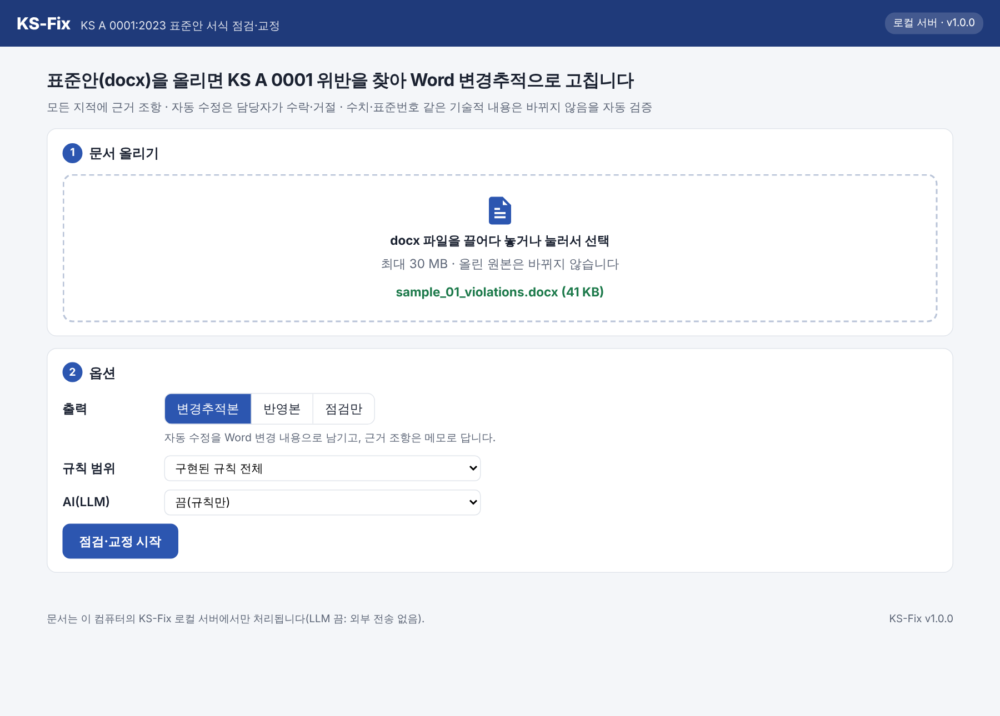
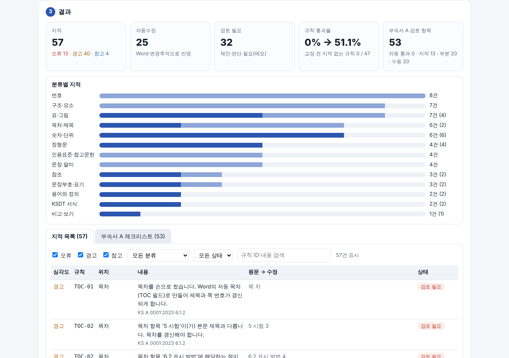
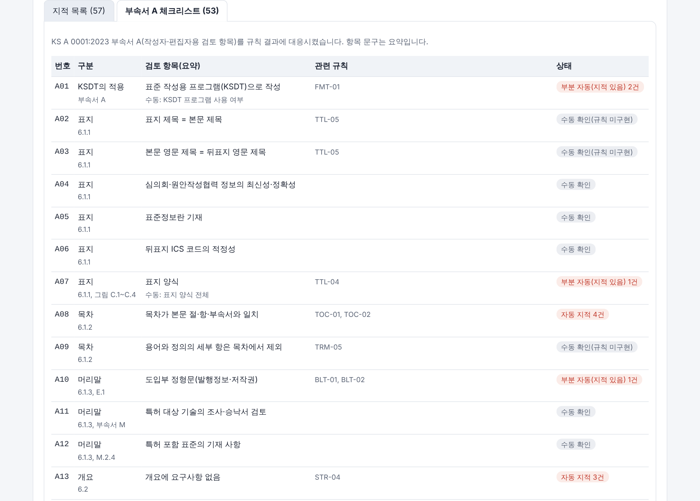
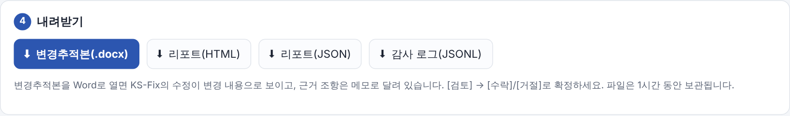
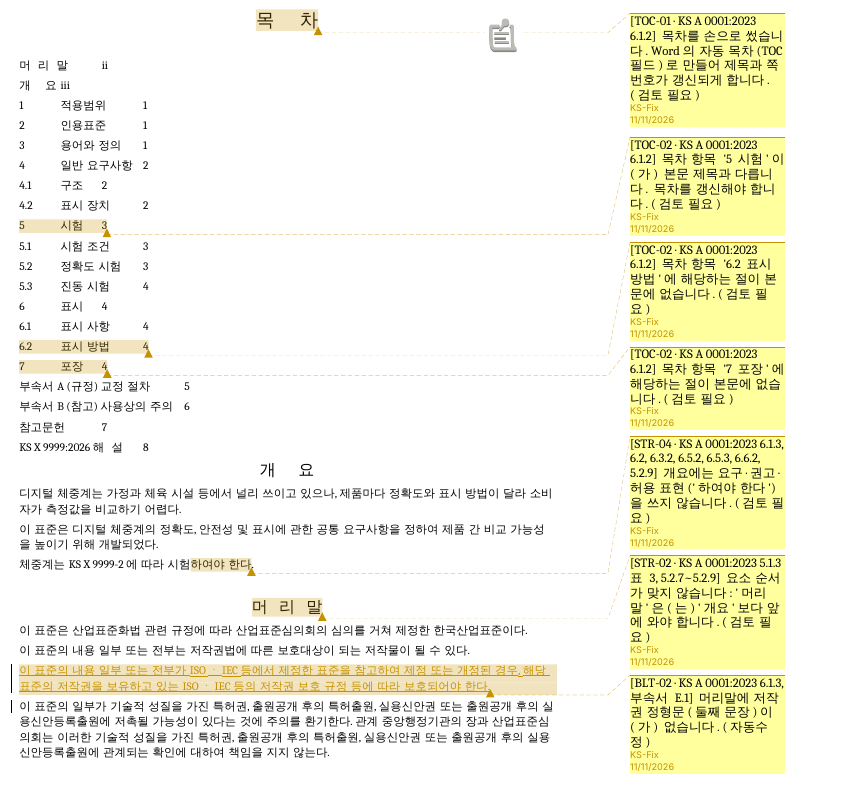
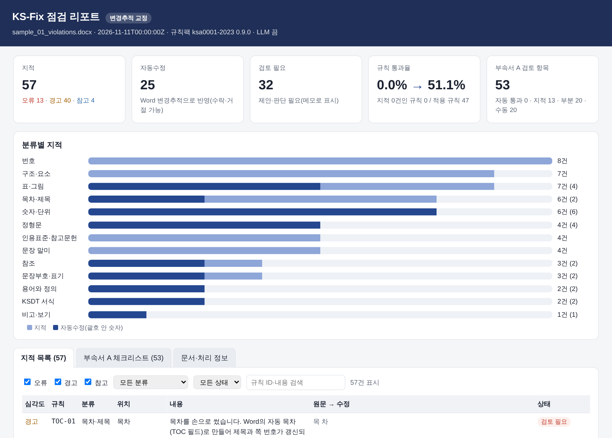

# [구동안내서 초안] KS-Fix: KS A 0001 표준안 서식 자동교정 AI

> 양식 2-1 항목 순서대로 쓴 초안입니다. A4 3~5쪽 PDF로 옮길 때 그림(`images/`)을 함께 넣습니다.
> 공공 GitLab: https://gitlab.aigov.go.kr/xieaqur571/project20261109 (태그 v1.0.0)

## 1. 실행 환경

| 구분 | 내용 |
|---|---|
| 운영체제 | Windows 10/11(실행파일), 또는 Windows·macOS·Linux(Python·Docker) |
| 필수 | 실행파일: 없음 / pip: Python 3.11 이상 / Docker: Docker Desktop 또는 Docker Engine |
| 브라우저 | 최신 Chrome·Edge(웹 UI) |
| 하드웨어 | 메모리 4 GB 이상(LLM 사용 시 모델 크기 + 2 GB 이상), 디스크 300 MB |
| 네트워크 | 필요 없음(LLM 끔 기본, 로컬 처리). 브라우저 데모만 첫 실행 때 인터넷 필요 |
| 선택 | Ollama(로컬 LLM: EXAONE 3.5 7.8B, Gemma 3 4B) |

## 2. 설치·실행 절차

**① Windows 실행파일(권장, 설치 없음)**
1. GitLab 프로젝트의 릴리스(태그 v1.0.0)에서 `ksfix-win64.zip`을 받아 압축을 풉니다.
2. `ksfix\ksfix.exe`를 두 번 누릅니다 → 검은 창(로컬 서버)이 뜨고 브라우저가 자동으로 열립니다(http://127.0.0.1:8765).
3. SmartScreen 경고가 나오면 ‘추가 정보 → 실행’. 끝낼 때는 검은 창을 닫습니다.
4. (확인용) 명령 프롬프트에서 `ksfix.exe --selftest` → 7개 항목이 모두 `[통과]`로 나오면 정상입니다.

**② Python(pip)**
```bash
pip install ".[web]"
```
```bash
ksfix serve --open
```

**③ Docker**
```bash
docker compose up --build
```
→ 브라우저에서 http://127.0.0.1:8765

**④ 브라우저 데모(선택)**: `python scripts/build_pages.py` → `python -m http.server 8000 --directory site` → http://127.0.0.1:8000 — 문서는 브라우저 안에서만 처리되며 서버로 보내지 않습니다(온라인 공개 주소 없음).



## 3. LLM 연결 설정(선택)

- 기본값은 **LLM 끔**이며 모든 핵심 기능이 LLM 없이 동작합니다.
- 로컬 LLM 연결(Ollama):
  1. Ollama 설치 후 모델 받기: `ollama pull exaone3.5:7.8b`, `ollama pull gemma3:4b`
  2. 웹 UI ‘AI(LLM)’에서 `ollama-exaone` 또는 `ollama-gemma` 선택(명령줄: `--llm ollama-exaone`)
- 다른 모델·기관 API: `config/llm_profiles.yaml`(예시 파일 복사) 또는 환경변수 `KSFIX_LLM_BASE_URL`·`KSFIX_LLM_MODEL`·`KSFIX_LLM_API_KEY` — OpenAI 호환 API면 코드 수정 없이 교체됩니다. 외부 API를 고르면 전송 경고가 표시됩니다.
- 모델 2종 평가(합성 문장 60개, `ksfix eval`, CPU): EXAONE 3.5 7.8B — 유형 정확도 75 %, 허용 판별 97 %, 문장당 24.5초 / Gemma 3 4B — 82 %, 97 %, 9.4초. 두 모델 모두 같은 설정으로 주요 기능 동작

## 4. 모의데이터 안내

모두 직접 만든 가상의 표준안(‘KS X 9999 디지털 체중계’)으로 실제 KS 문서·민감정보가 없습니다. 저장소 `samples/`에 있고 실행파일 zip에도 들어 있습니다.

| 파일 | 용도 | 투입 방법 |
|---|---|---|
| `sample_01_violations.docx` | 위반 52건을 넣은 표준안(시연용) | 웹 UI에 올리기 → 변경추적본 |
| `sample_02_clean.docx` | KS A 0001에 맞게 쓴 정상본(오탐 확인) | 웹 UI에 올리기 → 점검만 |
| `sample_03_messy_styles.docx` | 스타일 없이 손서식만 쓴 문서(구조 인식 확인) | `ksfix inspect` 또는 웹 UI |

결과 예시(실행 없이 보기): `examples/`(변경추적본·반영본·리포트 HTML·JSON·감사 로그)

## 5. 기능 사용 순서(핵심 흐름 3가지)

**흐름 1 — 점검 → 변경추적본 확인**
1. `sample_01_violations.docx`를 끌어 놓고 출력 ‘변경추적본’ → **점검·교정 시작**
2. 요약 카드(지적 57건, 자동수정 25건, 규칙 통과율 0 % → 51 %)와 분류별 막대, 지적 목록(근거 조항·조치) 확인
3. ‘부속서 A 체크리스트’ 탭에서 검토 항목 53개의 자동 판정 확인





**흐름 2 — 변경추적본·반영본·리포트 내려받기**
1. ‘내려받기’에서 변경추적본(.docx)·리포트(HTML·JSON)·감사 로그를 받습니다.
2. 변경추적본을 Word로 열면 고친 곳마다 변경 표시와 근거 메모(`[규칙 ID · 근거 조항] … (자동수정)`)가 있고, ‘검토 → 수락/거절’로 결정합니다. 필드 업데이트 질문에 ‘예’를 누르면 목차가 갱신됩니다.
3. 출력 ‘반영본’을 고르면 수정을 모두 반영한 문서를 받습니다.







**흐름 3 — LLM 모델 교체 비교(선택)**
1. ‘AI(LLM)’에서 `ollama-exaone` 선택 → 처리 → ‘할 수 있다’ 문장의 AI 판정(허용 → “…해도 된다” 제안, 가능성 → 지적 없음) 확인
2. `ollama-gemma`로 바꿔 같은 문서를 처리해 결과 비교
3. 정량 비교: `ksfix eval --profiles ollama-exaone,ollama-gemma` → `docs/eval/modal_verbs_eval.md`

## 6. 알려진 제약 사항

- 입력은 .docx만(.hwp·.doc은 .docx로 저장 후 사용), 최대 30 MB
- 의미 판단 항목은 제안·메모만 하고 자동으로 고치지 않음. AI 제안은 사람이 변경추적에서 수락해야 반영
- 카탈로그 84종 중 47종 + 신뢰성 3종 구현(표지 서식·쪽 머리·용지 여백 등 34종 미구현)
- 목차 번호·쪽수는 Word에서 필드 갱신 필요
- Windows 실행파일은 코드 서명 없음(SmartScreen 경고), PyInstaller(GPL + 부트로더 예외)로 빌드 — 배포 가능
- LLM 모델 라이선스: EXAONE 3.5는 비상업 라이선스(업무 활용 전 확인), Gemma 3는 Gemma Terms of Use. 모델 파일은 포함하지 않음

## 7. 개발 경위 요약

- **문제 인식**: KS는 5년마다 확인·개정 검토를 거치며, 표준안은 KS A 0001:2023의 서식(요소 순서, 정형문, 번호, 표·그림, 단위 표기, 요구·허용 표현 등)을 따라야 한다. 이 검토는 대부분 사람이 눈으로 하고, 발간본에도 이전 판 정형문·목차 미갱신·단위 표기 편차가 남아 있다.
- **접근 방식**: ① 확정할 수 있는 항목은 조항 근거가 있는 규칙으로, ② 의미 판단이 필요한 문장만 AI로, ③ 모든 수정은 Word 변경추적·메모로 남겨 담당자가 결정, ④ 수치·표준번호 같은 기술적 내용은 자동 검증(실패 시 철회), ⑤ LLM·인터넷 없이도 동작(업무망 고려).
- **검증**: 합성 표준안 3종 골든 테스트(위반본 결정형 규칙 재현율 100 %, 정상본 오류·경고 0건)와 발간 KS 문서 2종 로컬 검증(외부 전송 없음, 저장소 미포함). 실제 문서에서 찾은 오탐은 합성 테스트로 옮겨 고정했다.
- **참고 자료**: KS A 0001:2023 표준의 서식과 작성방법, ECMA-376(Office Open XML), 오픈소스(python-docx, lxml, FastAPI, Jinja2, PyYAML, Pyodide, Ollama) — 라이선스는 `THIRD_PARTY_NOTICES.md`
